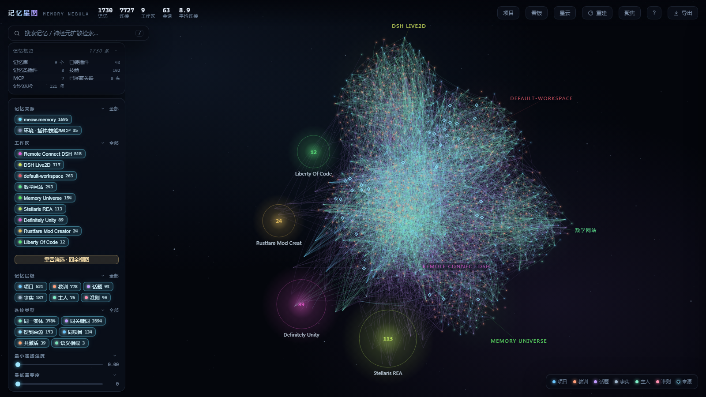
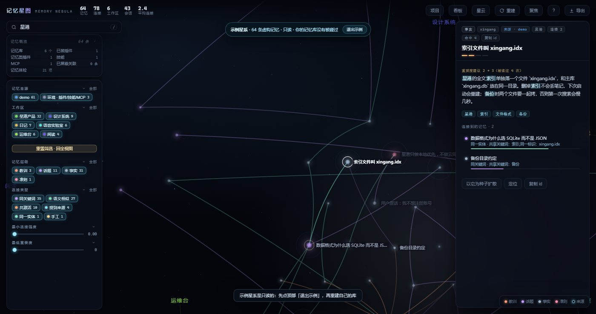
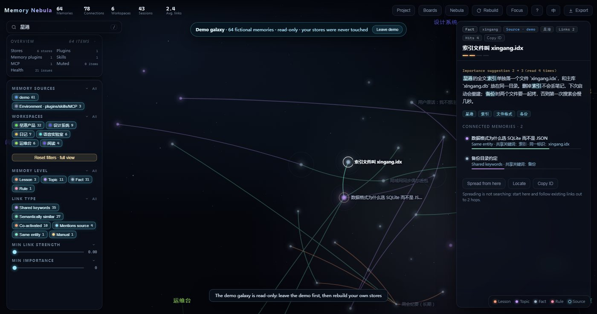
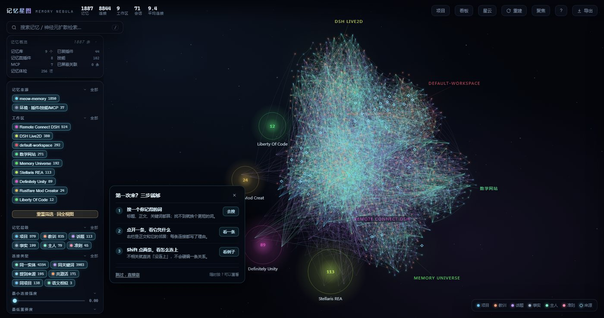
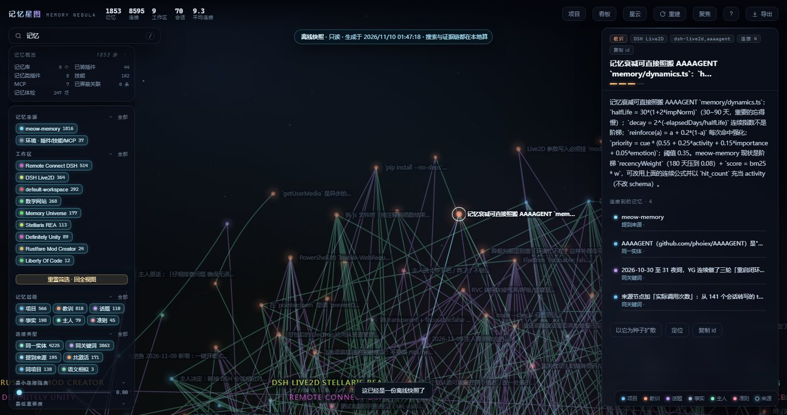

# Memory Nebula · memory-nebula

[](https://github.com/hanhan9999999999999999999/dsh-memory-nebula/actions/workflows/ci.yml)
[](https://www.npmjs.com/package/dsh-memory-nebula)
[](https://github.com/hanhan9999999999999999999/dsh-memory-nebula/blob/main/LICENSE)

A DSH plugin that pulls memories out of every workspace **and every memory plugin**, turns them into a **nebula of evidence-backed connections**, and lets both you and the AI follow those connections the way neurons do.



No memories yet? The empty state offers three ways in, plus a built-in demo galaxy:







Export the whole graph (text included) as one self-contained HTML for offline reading:



- One icon in the sidebar opens the whole nebula (deep-space style: zoom, filter, search).
- Every other memory database is opened **read-only**. The plugin only writes under `$DSH_HOME/memory-nebula/`.
- It is not just a picture: the host registers **9 tools** plus a per-turn prompt, so the AI can walk a connection into another project and read the other half of a memory.
- Sources are **pluggable**: meow-memory SQLite, any notes directory, any SQLite table, or JSONL pushed by a remote service — all behind one adapter contract.

## What it does

| Capability | Where |
| --- | --- |
| Nebula / galaxy / time-spiral views | sidebar icon; `1` `2` `3` |
| Spreading-activation recall across workspaces | `nebula_recall`, search box `/` |
| Full text, origin, same-session neighbours, who mentioned it | click any node |
| Evidence chain: how two memories are actually connected | select one, `Shift`-click another |
| **Cross-plugin bridge**: what another plugin just injected → the neighbours it did not | `nebula_bridge`, per-turn injection |
| **Attach a new memory store**: SQLite / notes dir / JSONL | `nebula_sources`, `sources.json` |
| **Push from a remote memory service** | `nebula_ingest`, `POST /ingest` |
| Export the whole graph (MD report / JSON) | `GET /export?format=md\|json` |
| Corrections: mute a wrong edge | `×` next to a neighbour, or `nebula_link(action="mute")` |
| Memory hygiene (six failure modes) | left panel, board `B`, `nebula_hygiene` |
| Export visible PNG / subgraph JSON | top bar |
| First open: three ways in, or a built-in demo galaxy | empty-state card, `?demo=1` |
| Single-file snapshot: the whole graph (with text) as one offline HTML | Export → “whole graph · single HTML”, `GET /share` |
| Scoped share: one workspace, one project, or a node’s 2-hop neighbourhood | Export menu, `GET /share?scope=ws:<workspace>` |
| Privacy filter: drop the diary workspace, a level, a project or a status before export | Export menu, `GET /share?hide=ws:diary` |
| **Bilingual UI**: interface and offline snapshots in English, untranslated strings fall back to Chinese | top-bar language button, `?lang=en` |
| **One-click diagnostics**: version, environment, graph size and last error, with no memory text or paths | `?` → “Copy diagnostics”, `GET /diagnostics`, `--diagnose` |
| First-visit guide: search → open one memory → trace one chain, skippable | appears once, replay from `?` |
| Time replay (everything up to a day) | timeline in the time view |
| Keyboard map | `?` |

## Quick start

From the plugin market (recommended): add the index
`https://unpkg.com/dsh-memory-nebula@1.1.8/market/index.json` under
Plugins → Discover, search for “Memory Nebula”, and install. Run the doctor in step 2.5 afterwards.

Or install from this checkout:

```powershell
# 1) link the plugin (either way)
New-Item -ItemType Junction -Path "<profile>\node_modules\dsh-memory-nebula" -Target "<plugin>"
npm install <path>\dsh-memory-nebula-1.1.8.tgz --prefix <profile>

# 2) profile package.json: add the dependency AND the bundle
#    dependencies:        "dsh-memory-nebula": "file:../../plugins/dsh-memory-nebula"
#    dsh.profile.bundles: "dsh-memory-nebula"

# 2.5) read-only preflight: Node, dependency, bundles and files; exits 1 only on fail
node "<profile>\node_modules\dsh-memory-nebula\scripts\doctor.mjs" --profile "<profile>"

# 3) restart DSH, open the "Memory Nebula" sidebar panel
```

No restart, or the host still runs old modules:

```powershell
powershell -ExecutionPolicy Bypass -File sidecar.ps1 start   # Windows, port 7890, finds node itself
node lib/standalone.mjs --port 7890                          # other systems, scans the current directory
```

`sidecar.ps1` also takes `-Port`, `-Root <extra scan dir>` and `-Node <node.exe>`; `status` / `stop` only touch that port.

The page probes `/ping` on both legs and picks the newer `build`; a banner explains when the host lacks endpoints.

Self-checks:

```bash
npm test                 # 90 unit assertions
npm run check            # static release check
node scripts/smoke.mjs   # 63 contract assertions against a live instance
```

### Attaching a new memory store (three steps)

1. Ask the AI: *"run `nebula_sources`, then attach `<where your memories live>`."*
2. The AI reads [docs/integration-guide.md](docs/integration-guide.md) and picks a path:
   - **on disk (SQLite / notes)** → add a source to `sources.json`; hot-reloaded.
   - **API only** → have that plugin `POST /api/memory-nebula/ingest`, or call `nebula_ingest`.
   - **just need context once** → call `nebula_bridge(memory_ids=[…])`, no source needed.
3. Confirm with `GET /sources`: the new store must report "N nodes, 0 read errors".

Adapter contract and every `sources.json` field: [docs/adapters.md](docs/adapters.md).

## Docs

| File | Contents |
| --- | --- |
| [docs/integration-guide.md](docs/integration-guide.md) | **Integration manual for another AI**: three paths, decision tree, verification |
| [docs/adapters.md](docs/adapters.md) | Adapter contract, four built-in adapters, `sources.json`, safety boundary |
| [docs/recall-and-tools.md](docs/recall-and-tools.md) | Spreading activation, the nine tools, bridge budget, per-turn injection |
| [docs/architecture.md](docs/architecture.md) | Module map, request path, invariants |
| [docs/interface.md](docs/interface.md) | Views, interaction, detail panel, LOD, board / command palette, export |
| [docs/http-api.md](docs/http-api.md) | HTTP routes, `/ping` fields, ETag/304, error codes, body limits |
| [docs/security.md](docs/security.md) | Local-only boundary, CORS/CSRF, CSP, read-only guarantee, threat model |
| [docs/operations.md](docs/operations.md) | Read-only boundary, install, hot reload, known limits |
| [docs/release.md](docs/release.md) | Release checklist, versioning, packaging, rollback |
| [docs/compatibility.md](docs/compatibility.md) | Verified OS/Node/browser matrix, explicit non-support |
| [docs/distribution.md](docs/distribution.md) | Install/upgrade/rollback/uninstall, support flow, marketplace copy |
| [SECURITY.md](SECURITY.md) | Read-only boundary, HTTP protections and vulnerability reporting |
| [CONTRIBUTING.md](CONTRIBUTING.md) | Local development, test commands and contribution rules |
| [docs/testing.md](docs/testing.md) | 90 unit tests, 63 smoke checks, 21 security probes, browser probes |
| [docs/roadmap.md](docs/roadmap.md) | From 0.5 to 1.2: scoped sharing, first-run guidance, 10k-node performance, i18n and release support |
| [CHANGELOG.md](CHANGELOG.md) | Version history |

## Layout

```
lib/
  index.js            entry: 9 tools, prompt injection, /api/memory-nebula
  host/
    nebula.js         facade: index / cache / refresh / detail / bridge
    graph.js          build, score, prune, auditHygiene
    recall.js         seeds + spreading activation
    bridge.js         complementary bundle: ids → spread → drop seen → fit budget
    ledger.js         injection ledger shared across plugins
    adapters/         meow / notes / sqlite / ingest + discovery and config
    live.js           hot reload (recursive over lib/host, copy by mtime)
    http.js           routes (statically loaded)
  web/                front end (served from disk; refresh to apply)
scripts/smoke.mjs     63 read-only contract checks
scripts/release-check.mjs  static release check
scripts/bench.mjs     10k benchmark (build / recall / hygiene / snapshot / memory)
test/                 node:test unit suite (90 assertions)
```

## Privacy and security

- Read-only: every memory database is opened with `readOnly`; writes stay under `$DSH_HOME/memory-nebula/`.
- Local-only: the standalone engine binds `127.0.0.1`; cross-site reads get no CORS, cross-site writes get 403; the page ships a CSP.
- Full model and verification: [docs/security.md](docs/security.md).
- Performance budget and 10k measurements: [docs/benchmarks.md](docs/benchmarks.md).

## Version

`1.1.8`, MIT. Front-end changes apply on refresh; everything under `lib/host/` is hot-reloaded, while `http.js` / `index.js` / `live.js` need a DSH restart (or the standalone engine).
