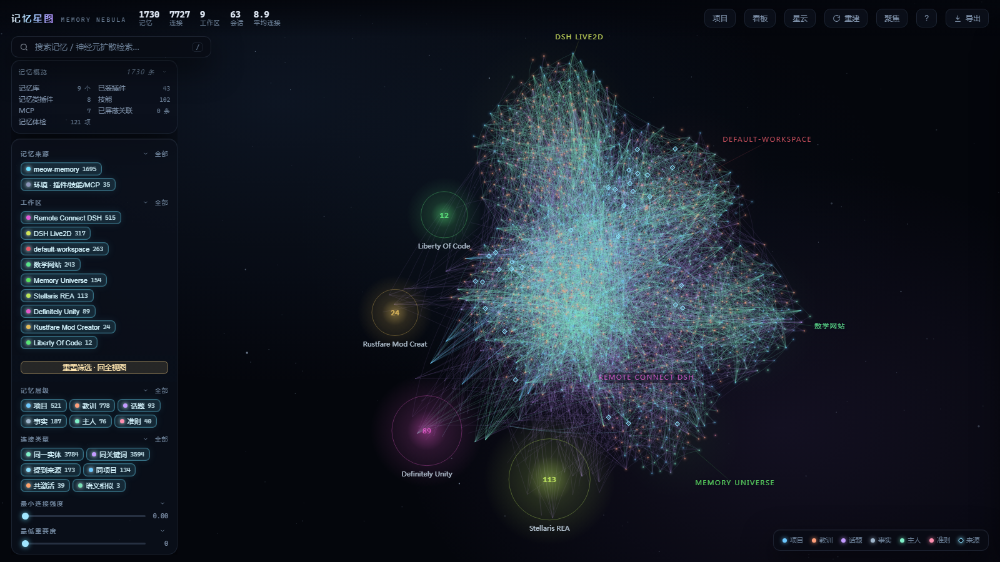
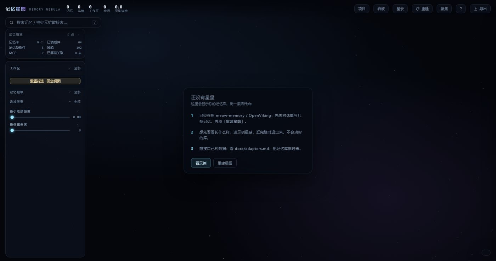
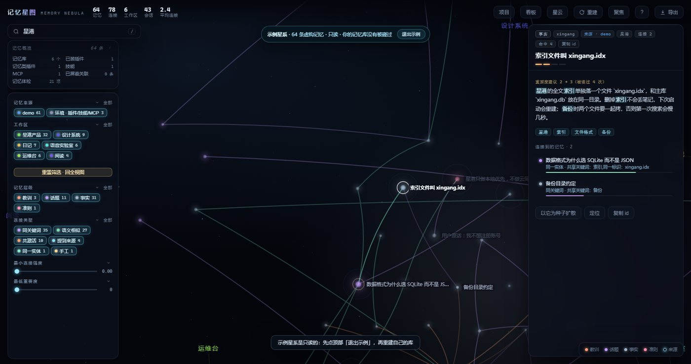
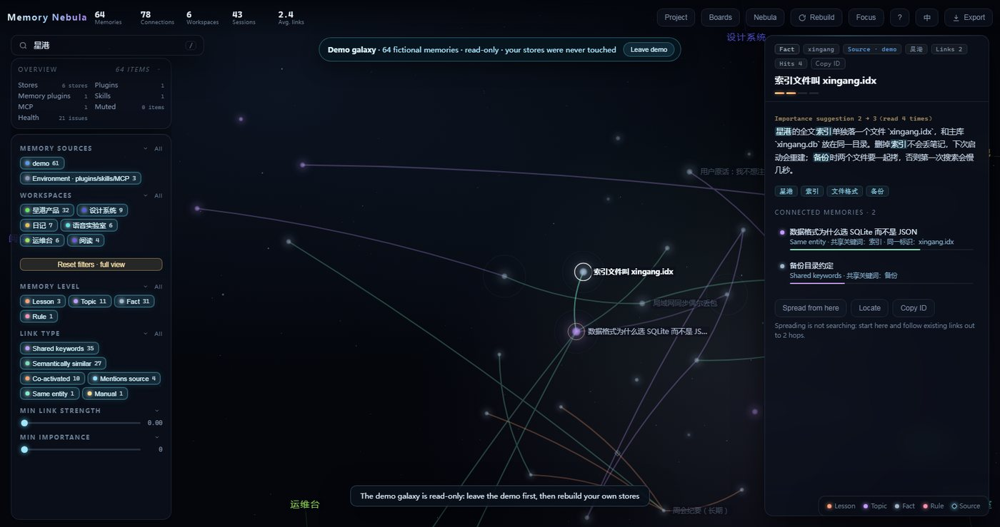
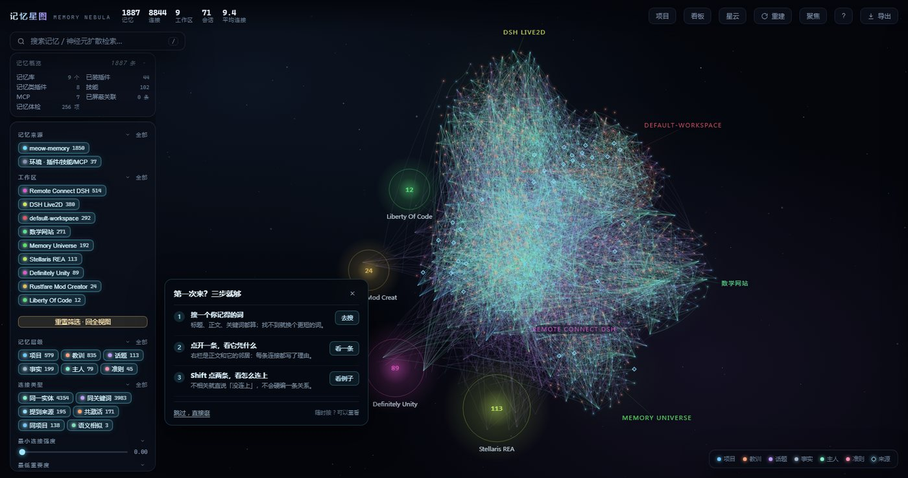

# 记忆星图 · memory-nebula

[](https://github.com/hanhan9999999999999999999/dsh-memory-nebula/actions/workflows/ci.yml)
[](https://www.npmjs.com/package/dsh-memory-nebula)
[](https://github.com/hanhan9999999999999999999/dsh-memory-nebula/blob/main/LICENSE)

[English](https://github.com/hanhan9999999999999999999/dsh-memory-nebula/blob/main/README.en.md) · [在线示例](https://hanhan9999999999999999999.github.io/dsh-memory-nebula/demo.html?lang=en) · [官网](https://hanhan9999999999999999999.github.io/dsh-memory-nebula/) · 在 DSH 里把散落在各个工作区、各个记忆插件里的记忆抽出来，算成一张**带证据的关联星云**，再从这张图上做「神经元式」的连带检索——以及，让别的插件注入了什么，星图就顺着连接补上它没注的那一半。



第一次打开、库里还没有记忆时，页面不会留一块空白——它给三条接入路径，也可以先进示例星系看看：









看完之后，可以把整张星图（含正文）导出成一个自包含 HTML，双击离线打开，搜索和证据链都还能用：


- 左侧栏一个图标 → 打开就是整片星云（Deep Space 风格，可缩放、可筛选、可搜索）。
- 不改任何别的插件的记忆库：所有记忆库都以 `readOnly` 打开，只写自己的目录 `$DSH_HOME/memory-nebula/`。
- 星图不只是一张画：宿主侧注册了 **9 个工具** + 一段每轮注入的提示，让会话里的 AI 在检索记忆时能**顺着连接把别的项目里的那一半一起读出来**。
- 记忆从哪来是**可插拔**的：meow-memory 的 SQLite、任意笔记目录、任意 SQLite 表、远端服务推来的 JSONL，都走同一套适配器契约。

```
   ┌─────────────── 记忆来源（全部只读）───────────────┐
   │ meow-memory  <ws>/.dsh-meow/memory.db + sessions/ │
   │ notes        任意 .md/.jsonl/.txt 目录（frontmatter）│
   │ sqlite       任意库，列名自动猜，写操作直接拒       │
   │ ingest       $DSH_HOME/memory-nebula/ingest/*.jsonl│
   └───────────────────────┬───────────────────────────┘
                           │ adapters/index.js 发现 + 扫描
                           ▼
  text.js 分词/实体 ──▶ graph.js 建图（6 类边 + 打分 + 剪枝）
                           │
                   nebula.js 门面（索引 / 缓存 / 巡检）
                           │
        ┌──────────────────┼────────────────────┬──────────────┐
        ▼                  ▼                    ▼              ▼
   http.js 页面      index.js 9 个工具    systemPrompt     bridge.js 补充包
   （iframe）         nebula_*            每轮邻域注入      ledger.js 注入账本
```

## 能做什么

| 能力 | 入口 |
| --- | --- |
| 看整片星云 / 星系 / 时间螺旋 | 左侧栏图标；`1` `2` `3` 切换三档 |
| 顺着连接检索（跨工作区） | `nebula_recall`、搜索框 `/` |
| 查一条记忆的全文、出处、同会话邻居、谁提到过它 | 点任意节点 |
| 证据链：两条记忆到底怎么连上的 | 选中后 `Shift` 点另一条 |
| **跨插件补充包**：别的插件注入了什么，就补它强相关却没读的邻居 | `nebula_bridge`、每轮注入（可配预算） |
| **接入新的记忆库**：SQLite / 笔记目录 / JSONL 推送 | `nebula_sources`、`sources.json` |
| **远端记忆服务推进来**（hindsight / openviking 之类） | `nebula_ingest`、`POST /ingest` |
| 导出整张图：给人看的 MD 报告 / 给 AI 看的 JSON | `GET /export?format=md\|json`、顶栏「导出」 |
| 纠错：把算错的关联按掉 | 详情里邻居右侧 `×`，或 `nebula_link(action="mute")` |
| 记忆体检（六类失效模式） | 左侧「记忆体检」、看板 `B`、`nebula_hygiene` |
| 导出当前视图 PNG / 可见子图 JSON | 顶栏「导出」 |
| **第一次打开**：空库给三条接入路径，或直接进示例星系 | 空态卡片「看示例」、`?demo=1` |
| **单文件快照**：整张星图（含正文）打包成一个 HTML，离线可看 | 顶栏「导出 → 整张星图 · 单文件 HTML」、`GET /share` |
| **范围分享**：只导出一个工作区 / 一个项目 / 选中节点 2 跳 | 导出菜单另两项、`GET /share?scope=ws:<工作区>` |
| **命令行快照**：CI / 定时归档不启端口，直接写 HTML | `node lib/standalone.mjs --share <file> [--scope …]` |
| **隐私过滤**：导出前整区隐去日记 / 按层级 / 项目 / 状态排除 | 导出菜单「隐去日记」、`GET /share?hide=ws:日记` |
| **中英双语**：界面与离线快照都可切英文，未翻译处回退中文 | 顶栏语言按钮、`?lang=en` |
| **一键诊断**：复制版本/环境/图规模/最近错误，不含正文与路径 | `?` →「复制诊断」、`GET /diagnostics`、`--diagnose` |
| **首访引导**：搜一个词 → 看一条证据 → 走一条链，三步可跳过 | 首次打开自动出现，`?` 里可重看 |
| **两万条级打开**：20,000 条 / 156,993 条连接，建图 2.53s、快照首屏 762ms | 无需切换；大图自动跳过生长动画，基准见 `docs/benchmarks.md` |
| 时间回放（只看某天及之前） | 时间视图底部时间轴 |
| 快捷键一览 | `?` 或顶栏「?」 |

## 快速开始

已经装好的机器上（`profiles/desktop`），只要打开「记忆星图」页面就有一张图；页面每 12 秒比一次 `sig`，别的会话写了新记忆会自动长出新星点。库里还没有记忆时，页面会给三条接入路径，也可以先点「看示例」；`…/memory-nebula/?demo=1` 可直达示例星系，逛完退出不会动真实库。

精选目录已收录（推荐）：[awesome-dsh-plugin 目录页](https://awesome-dsh-plugin.com/p/hanhan9999999999999999999/dsh-memory-nebula/)。

```powershell
dsh plugin --profile web add dsh-memory-nebula
```

也可以在 DSH 的「插件 → 发现」里添加索引
`https://unpkg.com/dsh-memory-nebula@1.6.4/market/index.json`，搜索「记忆星图」安装。
装完按下面的 2.5 跑一次 doctor。

想先看看，不装进 DSH：

```powershell
npx -y -p dsh-memory-nebula memory-nebula --demo
```

打开它打印的 `http://127.0.0.1:7891/api/memory-nebula/?demo=1`，看到的是内置示例库，不读也不写你的真实记忆。

也可以从仓库装到 DSH：

```powershell
# 1) 装进 profile（二选一）
New-Item -ItemType Junction -Path "<profile>\node_modules\dsh-memory-nebula" -Target "<plugin>"
npm install <path>\dsh-memory-nebula-1.6.4.tgz --prefix <profile>

# 2) profile 的 package.json 里加依赖与 bundles（只加 dependencies 不会重组）
#    dependencies:         "dsh-memory-nebula": "file:../../plugins/dsh-memory-nebula"
#    dsh.profile.bundles:  "dsh-memory-nebula"

# 2.5) 装完先体检：只读检查 Node/依赖/bundles/文件，fail 才退出 1
node "<profile>\node_modules\dsh-memory-nebula\scripts\doctor.mjs" --profile "<profile>"

# 3) 重启 DSH，打开侧栏「记忆星图」
```

不想重启 DSH，或宿主里跑的还是旧模块：

```powershell
powershell -ExecutionPolicy Bypass -File sidecar.ps1 start   # Windows，默认 7890，自动找 node
node lib/standalone.mjs --port 7890                          # 其它系统，默认扫当前目录
```

`sidecar.ps1` 还接受 `-Port`、`-Root <额外扫描目录>`、`-Node <node.exe>`；`status` / `stop` 只作用于指定端口。

不启动端口，直接从命令行写一份快照：

```powershell
node lib/standalone.mjs --demo --share .\snapshot.html
node lib/standalone.mjs --share .\work.html --scope ws:星港产品 --hide level:lesson

# 报告也能带走：md 或 json，范围语义与快照一致
node lib/standalone.mjs --export .
ebula.json --scope project:memory-nebula
node lib/standalone.mjs --export .
ebula.md --format md
```

`--share` / `--export` 都只建一次图就退出：`--scope` 支持 `all` / `ws:<工作区>` /
`project:<项目>` / `focus:<节点 id>`，`--hops` 控制 focus 的跳数（1–5，默认 2），
`--hide` 可逗号分隔多条规则（仅 `--share`）。

页面会并行探宿主与独立引擎的 `/ping`，自动选 `build` 较新的那条；宿主缺接口时顶部有横幅说明。

自检三条命令：

```bash
npm test        # 103 项单元测试
npm run verify  # 单测 + 发布静态检查（npm pack 的 prepack 会自动再跑）
node scripts/smoke.mjs   # 63 项接口契约（对运行中的实例）
```

### 接入一个新的记忆库（三步）

1. 问 AI：「用 `nebula_sources` 看看现在接了哪些来源，然后把 `<你的记忆在哪>` 接进来。」
2. AI 会读 [docs/integration-guide.md](docs/integration-guide.md)，判断属于哪种情况：
   - **落盘的 SQLite / 笔记目录** → 往 `sources.json` 加一条 source，重启页面即可（热载）。
   - **只有 API 的远端服务** → 让那个插件在写入后 `POST /api/memory-nebula/ingest`，或调 `nebula_ingest`。
   - **只想临时补上下文** → 直接 `nebula_bridge(memory_ids=[…])`，不用接来源。
3. `GET /sources` 或 `nebula_sources(verbose=true)` 确认新来源「读到了 N 条、没有读取失败」。

适配器契约、列名猜测规则、`sources.json` 全字段见 [docs/adapters.md](docs/adapters.md)。

装卸（junction + `dsh.profile.bundles`）、热载边界、sidecar 过渡通道见 [docs/operations.md](docs/operations.md)。

## 文档

| 分册 | 内容 |
| --- | --- |
| [docs/integration-guide.md](docs/integration-guide.md) | **给「别人的 AI」看的接入手册**：三种接入路径、判断树、逐步验证 |
| [docs/adapters.md](docs/adapters.md) | 适配器契约、四种内置适配器、`sources.json` 字段、安全边界 |
| [docs/data-and-edges.md](docs/data-and-edges.md) | 数据从哪来；7 类边怎么算、怎么剪枝；来源节点 |
| [docs/recall-and-tools.md](docs/recall-and-tools.md) | 扩散激活检索；九个出口、补充包预算与每轮注入 |
| [docs/interface.md](docs/interface.md) | 三种视图、交互、详情面板、LOD、看板/命令面板/主线、时间回放与导出 |
| [docs/http-api.md](docs/http-api.md) | HTTP 路由、`/ping` 字段、ETag/304、错误码、请求体限制 |
| [docs/security.md](docs/security.md) | 本机服务边界、CORS/CSRF、CSP、只读保证、威胁模型与验证 |
| [docs/operations.md](docs/operations.md) | 只读边界、装卸、已知限制、sidecar、发布信息 |
| [docs/release.md](docs/release.md) | 发布前检查清单、版本策略、打包/安装/回滚 |
| [docs/compatibility.md](docs/compatibility.md) | 已验证的平台/Node/浏览器矩阵，以及明确不支持的组合 |
| [docs/distribution.md](docs/distribution.md) | 安装/升级/回滚/卸载、支持流程、市场文案与发布检查 |
| [docs/troubleshooting.md](docs/troubleshooting.md) | 出问题时先看这里：doctor、版本漂移、空图、3D/快照边界、隐私与工单材料 |
| [SECURITY.md](SECURITY.md) | 只读边界、HTTP 防护与漏洞报告 |
| [CONTRIBUTING.md](CONTRIBUTING.md) | 本地开发、测试命令与提交约定 |
| [SUPPORT.md](SUPPORT.md) | 提 issue 前先做什么、要带什么、绝不能贴什么 |
| [docs/verified.md](docs/verified.md) | 每一条结论背后的实测证据 |
| [docs/architecture.md](docs/architecture.md) | 模块分工、请求路径、不能破的不变量 |
| [docs/testing.md](docs/testing.md) | 103 项单测、63 项冒烟、25 项安全探针、浏览器探针清单与手工验收 |
| [docs/roadmap.md](docs/roadmap.md) | 从 0.5 到 1.2：切片分享、首访引导、万条性能、国际化与发行支持 |
| [CHANGELOG.md](CHANGELOG.md) | 版本变更 |

## 目录结构

```
lib/
  index.js            插件入口：注册 9 个工具、注入提示、挂 /api/memory-nebula
  client.js           左侧栏入口
  host/               引擎（只读取数、建图、检索、体检、转写解析）
    nebula.js         门面：索引 / 缓存 / 巡检 / publicGraph / detail / bridge
    graph.js          建图、打分、剪枝、auditHygiene
    recall.js         seed + 扩散激活
    bridge.js         补充包：ids → 扩散 → 排除已读 → 预算内挑几条
    ledger.js         注入账本：谁什么时候注入过什么（跨插件共用）
    adapters/         来源适配器（meow / notes / sqlite / ingest）+ 发现与配置
    live.js           引擎热载（递归枚举 lib/host，按 mtime 复制再 import）
    http.js           路由（启动时静态加载）
  web/                前端（每次请求从磁盘读，改完刷新即生效）
    app.js            状态、面板、筛选、命令面板、导出、时间轴
    render.js         2D 星云：力导向 + 区块点亮 + Path2D 批处理
    space3d.js        3D 星系 / 时间螺旋：WebGL 光点
scripts/smoke.mjs     只读契约自查（63 项）
scripts/release-check.mjs  发布静态检查
scripts/bench.mjs     10k 性能基准（建图 / 检索 / 体检 / 快照 / 内存）
test/                 node:test 单元测试（103 项）
sidecar.ps1           Windows 独立引擎开关
```

## 隐私与安全

- 只读：所有记忆库以 `readOnly` 打开；写入只落在 `$DSH_HOME/memory-nebula/`。
- 只连本机：独立引擎绑定 `127.0.0.1`；跨站读拿不到 CORS、跨站写 403；页面带 CSP。
- 独立引擎可加 `--token <至少 12 字符>` 开本机口令；不传时保持本地即开即用，宿主内走 DSH 的 Host/认证围栏。开启后浏览器直接打开页面会看到输口令的登录页，口令错误不会放行。
- 全文细节与威胁模型见 [docs/security.md](docs/security.md)。
- 性能预算与 10k 实测见 [docs/benchmarks.md](docs/benchmarks.md)。

## 支持与反馈

- 先跑 `node scripts/doctor.mjs`，再对照 [docs/troubleshooting.md](docs/troubleshooting.md)；多数空白页/空图/3D 问题能在那里解决。
- 提 issue 请用仓库里的模板，附 `doctor` 输出、DSH/Node/系统版本、复现步骤；**不要贴记忆正文、token、`.npmrc` 或私有路径**。
- 安全漏洞走私密 advisory，见 [SECURITY.md](SECURITY.md)。完整支持边界见 [SUPPORT.md](SUPPORT.md)。

## 版本与许可

- 当前版本 `1.6.4`，MIT。
- 打包内容：`lib/`、`scripts/`、`docs/`、`cordis.patch.yml`、`README.md` / `README.en.md`、`CHANGELOG.md`、`LICENSE`、`sidecar.ps1`（`test/` 与 `dev/` 不进包）。
- 前端改动刷新页面即生效；`lib/host/` 下所有引擎文件（含 `adapters/`、`bridge.js`、`ledger.js`）由 LiveEngine 热载，`http.js` / `index.js` / `live.js` 改动要重启 DSH 或走独立引擎。
