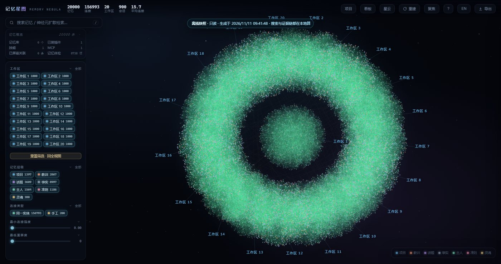

# 性能基准：一万条记忆

这一页回答一个问题：**记忆库长到一万条，打开还来不来得及看？**


结论先给：在 10,000 条记忆 / 78,593 条连接、单文件快照 11.6MB 的条件下，
无头 Edge（软件渲染、1680×874）从导航到统计条出现 **652–692ms**，建图 1.3s，
检索 4.4ms，体检 0.73s，生成快照 75ms。目标线是首屏 1.5s，实际留了一倍余量。

## 怎么测

```bash
# 纯后端：建图 / 检索 / 体检 / 证据链 / 快照 / 内存
node --expose-gc scripts/bench.mjs --nodes 10000 --json

# 同时写出一份 10k 单文件快照，给浏览器测首屏
node --expose-gc scripts/bench.mjs --nodes 10000 --share-out bench-10k.html

# 首屏：无头 Edge 打开快照，记录「导航 → 统计条出现」
node dev/cdp-bench.mjs bench-10k.html bench-10k.png
```

- 数据是确定性合成：20 个工作区、900 个会话、30 个项目、900 个词的词表；
  每条 8 行正文，含路径、URL、引号实体，故意让实体边和关键词边都长出来。
- 建图跑 3 次取中位数；检索 8 种查询各 5 轮取中位数。
- 机器：Windows，Node 24.17，无头 Edge（`--disable-gpu`，软件光栅化），
  视口 1680×874。**这不是高端显卡的成绩，是「没有 GPU 也能开」的下限。**
- 首屏轮询读取 `#stats`，统计条一出现就停表；`resources` 为 0，快照确实完全离线。

## 数字

| 指标 | 目标 | 10k 实测 | 说明 |
| --- | --- | --- | --- |
| 建图 | ≤ 3,000ms | **1,298ms** | 10,000 节点 / 78,593 边 |
| 首屏（导航→统计条） | ≤ 1,500ms | **652–692ms** | `loadMs` 63–151ms + 首次 `draw` 10–18ms |
| 检索 | ≤ 80ms | **4.4ms** | 8 种查询 × 5 轮中位数 |
| 体检 | ≤ 1,500ms | **726ms** | 4,248 项问题 |
| 证据链 | ≤ 50ms | **5.7ms** | 1 跳 |
| 单文件快照 | ≤ 2,000ms | **75ms** | 11.6MB，含全部正文 |
| JS 堆 | ≤ 300MB | **131MB** | `--expose-gc` 后 `heapUsed` |

同一台机器上，0.8 之前是 **16,960ms** 首屏：不是建图慢（`loadMs` 只有 30ms），
是 420 轮力导向 + 逐帧生长动画 + 每帧全量重绘叠出来的。

## 改了什么

1. **万条图不再跑生长动画与 420 轮力导向。** 初始位置本来就按工作区分好簇，
   超过 3,000 节点时直接全亮、跳过每帧模拟；1,000–3,000 节点把轮次降到 180。
   这是首屏 17s → 0.7s 的主因。
2. **大图候选集改用稀有词签名。** 节点超过 1,000 时，关键词配对只从 `node.sig`
   的 26 个稀有词里取，小图仍用全量 token 保召回；实体配对跳过超过 120 个成员的
   共享路径/版本号。建图 4.9s → 1.3s。
3. **分词器改成单次字符扫描。** 三条 `matchAll` 正交换成一个循环，中文 bigram 与
   2–8 字 run 的行为保持不变。
4. **检索缓存 token 与邻接表。** 每张图只建一次 `df` / `tokensOf` / `adj`，
   后续查询复用；检索 188ms → 4.4ms。
5. **体检只分词一次。** `auditHygiene` 接收 `tokensById`，dup 用提前退出的
   Jaccard，stale 用关键词倒排；5.3s → 0.73s。
6. **大图改画点云。** 超过 3,000 节点时，普通节点不再画发光贴图，改画 1–2px
   小颗粒；边的透明度再乘 0.16。否则一万个光点与七万条线叠在一起是一堵白墙。
   首次绘制 110ms → 10–18ms，截图里的簇结构也终于看得清。

## 边界与诚实说明

- 这是**合成数据**：结构像真实记忆库（多工作区、跨区桥、会话共激活、来源节点），
  但正文长度与关键词分布是生成的。真实库的 1,853 条在开发机上首屏低于 1s。
- 3D 视图不在这次基准里。10k 的 2D 画布已经能开，3D 仍建议在几千条以内使用；
  超过 3,000 条时界面默认停在 2D。
- `rss` 峰值约 1GB，主要来自 11.6MB 快照字符串 + 78k 边的临时对象；
  `heapUsed` 131MB 是更接近「常驻」的数字。真要跑到 5 万条，需要再做分页/裁剪。
- 数字会随机器、浏览器、缩放与筛选变化。复测请用同一脚本、同一视口，
  不要用「感觉快了」代替。

## 2 万条（1.2.0 支持）



同一脚本 `--nodes 20000`，1.2.0 实体配对上限调整后（2026-11-11）：

- 建图 **2.53s**、20,000 节点 / **156,993 条边**、0 孤立、平均度 15.70；
- 检索 8.8ms、体检 1.47s、快照 158ms / 旧格式约 23.1MB；
- **JS 堆 248MB**、RSS 2.3GB；单文件快照 `file://` 首屏 **947ms（热缓存）/ 4.7s（全新 profile 冷启动）**（headless Edge，1680×1000）。
- 1.3.0 起快照按列存：20,000 节点 / 156,993 边降到 **19,996,814B / 174ms**；同一台机器实测新浏览器 profile **762ms**、热 profile **572ms**、检索 52ms、搜索 704ms、详情 116ms、证据链 <1ms。
- 10k 不受影响：1.23s / 78,593 条边 / 131MB。

20k 建图与堆已回到 3s / 300MB 目标内，可以作为「大库」支持；3D 仍建议在 3,000 条
以内使用。关键词边在这个规模已被 df=70 滤掉，图靠实体/语义/共激活边保持连通；
再往上到 5 万条，这些边也不够，才会出现断崖。

## 5 万条（1.9.0 起分层支持）

2026-11-14 用同一脚本跑 `--nodes 50000`（`node --expose-gc scripts/bench.mjs --nodes 50000`）：

| 指标 | 1.8.0（改前） | 1.9.0（改后） |
| --- | --- | --- |
| 连接 / 孤岛 | 280 边 / 49,567 孤岛（99.1%） | **197,569 边 / 0 孤岛**，avgDegree 7.9 |
| 建图 | 5,115ms | 5,799.7ms |
| 检索 | 29ms | 32.1ms |
| 体检 | 3,209ms | 3,518.5ms（25,024 项） |
| 证据链 | — | 26.1ms |
| 整图 JSON | 22.30MB | 22.30MB（整图仍这么大，但**首屏不再整包**） |
| 首屏（默认 10,000 条） | — | **4.26MB（−80.9%）**，gzip 0.38MB、br 0.35MB |
| 单文件快照 | 43.8MB | **16.6MB / 20,000 节点**（`/share?limit=` 默认裁剪） |
| 一帧（5 万节点 /15 万边） | 477.8ms | **11.5ms**（簇间聚合线） |
| 放大后候选边 | 150,000（全量） | **1.19%**（1,785 条） |
| `pick()` × 2,000 | 线性遍历 | **6.5ms**（网格查询） |
| JS 堆 / RSS | 360MB / 2.0GB | 462MB / 2.2GB |

结论与边界：

- 5 万条现在**能打开、能连起来、能分页往下加载**：首屏 10,000 条 4.26MB，底部「继续加载」按名次取下一页；
  超过 2 万且缩小时边画成簇间聚合线，放大后只画视口内的边。
- 取样配对（关键词窗口 3 / token 2 / 实体 3）只在 **>20,000** 生效；1 万条仍 78,593 边、
  2 万条仍 156,993 边，与改动前逐条一致，小库的手感不变。
- 合成词表仍是 900 词，5 万条下这个词表比真实库更「平」；真实库的度数分布若更偏，
  届时按 `NEBULA_GRAPH_TIMING=1` 的阶段数据再调窗口，不凭感觉。
- 3D 空间视图仍是全量绘制，5 万条请用 2D 主画布；3D 的大库支持留到 2.0。
- 建图、体检、快照都是秒级（5.8s / 3.5s / 1.6s），首屏感知靠分页与压缩，不靠「把库缩小」。

## 动态 df 上限原型（未采用）

试过把关键词 df 上限从固定 70 改为随规模放大（最多 1200），并按重要度只取
每个词的 120 条 posting 两两配对。结果：5 万条从 280 条边变成 45,961 条边，
图能连起来，但建图 6.7s、RSS 2.2GB，仍高于目标线；1 万条则从 78,593 条边
变成 76,729 条、建图 2.1s。**这个原型没有发布**：它让 1 万条变慢，却没有把
5 万条带进预算。1.9.0 走的是另一条路——取样配对把边连起来、分页与视口裁剪把
传输和绘制压下去，小库指标一条不动。

## 真实库的浏览器预算（1.11.1 起）

合成数据能证明「能打开」，但用户第一眼看到的是**他自己那点真实的记忆**。
所以另外量一条线：本机真实库 **2,222 条 / 11,128 条连接**，无头 Edge（软件渲染、1440×900），
从导航到第一帧：

| 项 | 实测 |
| --- | --- |
| 导航 → 第一帧（墙钟） | **449ms** |
| DOMContentLoaded / load | 45ms / 115ms |
| `/graph` 耗时 · 传输体积 | 61ms · 235KB（br） |
| 第一帧绘制 | 1.1ms |
| 方向键连按 24 次（中位 / p90 / 最大） | 0.5ms / 1.4ms / 3ms |
| 切三维 → 第一帧 | 129ms（单帧 12.2ms，屏上 299 个光点） |
| JS 堆 | 15MB |

```bash
# 用真实库量：起服务 + 无头 Edge，读 __nebulaDebug 与 Performance 时间线
node dev/verify-budget.mjs
```

预算线：首屏 < 8s、第一帧绘制 < 400ms、方向键中位 < 120ms、三维第一帧 < 4s、三维单帧 < 250ms
（软件渲染）。这四条是回归门——任何一次绘制路径的改动都要重跑。

## 5 万条：在浏览器里一页页点到头（1.11.8）

真实库只有 2,222 条，所以大库这一侧用**真实形状**的 52,073 条库（4 个工作区 × 12,500，
语料取自本机 9 个真库）。首屏只装第一页，剩下的靠用户点「继续加载」——这一轮把那几下也量了。

| 项 | 实测 |
| --- | --- |
| 首屏：导航 → 可交互 | **553–980ms**（三次跑） |
| 首屏：第一帧绘制 | 23ms |
| 首屏：`/graph` · 传输体积 | 216ms · 458KB（br，10,000 节点 / 32,167 边） |
| 首屏 JS 堆 | 61MB |
| 点一次「继续加载」（页面第一次点，服务刚建完图） | **1,323–1,358ms** 合计 |
| 点一次「继续加载」（热态） | **212–253ms** 合计，其中布局 + 首帧 25–35ms |
| 五页全点完（逐页） | 287 / 361 / 421 / 450ms |
| 全图 | 52,061 节点 · 178,358 边 · **157MB** 堆 |
| 全图时方向键（中位 / 最大） | **34ms / 38.6ms**（10k 时 0.7ms、20k 时 16.7ms；预算线 120ms） |

读法：**贵的是取数，不是画**。第二页 212ms 里 177ms 在等 `/graph`，布局加出帧只占 25–35ms；
翻到底之后方向键中位从 0.7ms 长到 34ms（节点数 ×5），仍在预算线以内四倍余量。

```bash
# 首屏 + 第二页 + 一路翻到底，9 项断言
node dev/verify-page2.mjs "D:/document/Memory Universe/.tmp-50k"
```

一条踩过的坑：探针第一版在「已经翻到底」之后去读分页条的文字，读到的是它**隐藏前**的旧文案
「还有 2073 条」，于是报了一条根本不存在的 bug。分页条收起时是 `hidden`，真相在 toast 里
（「已经加载全部 52073 条」）。**读隐藏元素等于读上一句话。**


## 长活有多长：事件循环上的空档（1.11.4）

前面几节量的是「页面多久能画出来」，这一节量的是**服务端有没有按住事件循环**——
在 DSH 里这两件事是同一件事：按住三秒，宿主主界面就三秒不回声。

2 万条真实形状库（22,049 条 / 74,880 边）上的实测，最长静默 = 期间事件循环一次都不回的最大间隔：

| 操作 | 同步实现（1.11.3） | 分片实现（1.11.4） |
| --- | --- | --- |
| `buildGraph` / `buildGraphAsync` | 3,651ms（最长静默 = 整段） | 4,006ms / 最长静默 **144ms** |
| `auditHygiene` / `auditHygieneAsync` | 3,624ms（最长静默 = 整段） | 2,961ms / 最长静默 **79ms** |
| `Nebula#refresh`（扫描 + 建图） | 3,791ms（静默 302ms 之前的那一段） | 3,791ms / 最长静默 **59ms** |
| 真机 `/refresh` 期间 `/ping` | 静默 = 整段 | 3,822ms 里最长 **37ms** |

代价：异步建图比同步慢约 **10%**（600+ 次 `setImmediate` 的调度开销）。分片按**时间**
（每 6ms 让一次）不按条数——按 1,024 条切，实测最坏的一片是 **1,767ms**（超长记忆两两比对），
等于没让。

```bash
# 进程内量同步 vs 异步的最长空档
node dev/probe-async.mjs .tmp-20k

# 真机：边发重请求边每 25ms 打一次 /ping，看最长间隔
node dev/probe-blocking.mjs http://127.0.0.1:62791
```

**别用 `fetch` 当尺子。** 同一个 `refresh`，`fetch` 复用连接池测出「静默 4,237ms」，
每次新建连接（`agent: false`）测出「静默 37ms」：前者量的是 HTTP 排队，后者才是事件循环。
745ms 的 `/recall` 被报成 738ms 静默，就是这把坏尺子的签名——探针必须说清「在量哪一段」。

## 读库也要让路：一个库的 110ms（1.11.19 更新）

`.all()` 一次拉完 vs `.iterate()` 逐行 + 每 512 行让路（12,500 行 / 11.4MB 的 meow 库）：

| 段 | 做法 | 耗时 | 说明 |
| --- | --- | --- | --- |
| `SELECT *` 全量 | `.all()` | 58.8ms | 一次性拉取，中间不让路 |
| 逐行迭代 | `.iterate()` | 53.2ms | 每 512 行一批，单批最慢 **2.2ms** |
| 只取 content | 逐行 `row.content` | 1.8ms | 不是瓶颈 |

12 个来源整体（52,047 条）：旧「每库一口气」**532ms / 最长空档 532ms** → 新「每 512 行让路」**450ms / 空档 23ms**。

真机（`node dev/probe-loop-lag.mjs`，独立连接 ping）：`/refresh` 6,950–7,109ms → **6,341 / 6,649ms**，
ping p90 10–11 → **8–9ms**，max 184–216 → **179–186ms**——**max 没降**，剩下的那块是 27.4MB 响应体的
`publicGraph + JSON.stringify`（进程内 183ms），不是一个能切开的循环。

复跑命令：`node dev/probe-scan-gap.mjs`（读库空档）、`node dev/probe-loop-lag.mjs`（真机 ping）、
`node dev/probe-refresh-gc.mjs`（GC 占比：一次 refresh 91 次 / 448ms / 单次最长 22.9ms）。
## 建图里的候选对：字符串键还是数字键（1.11.18 更新）

5 万条库（52,073 节点 / 178,262 边）上，只改候选对键的表示法，别的都不动：

| 段 | 1.11.17 | 1.11.18 | 说明 |
|---|---|---|---|
| 建图中位 | 6,399ms | **5,765ms** | `node dev/ab-1118.mjs`，各 5 次，自动换回/换出源码 |
| 真机 `/refresh` | 7,341–7,558ms | **6,950–7,109ms** | `node dev/probe-loop-lag.mjs` |
| 候选对段 `cand` | 669ms | 403ms | 27.6 万对的键不再拼字符串、不再 `indexOf` |
| `score` | 806ms | 638ms | 每对都要按同一套键查一次已有权重 |

同一次测量里还量了两个「以为贵、其实不贵」的东西：

- 正文转小写：52,049 条 / 2,773 万字，**一遍 `toLowerCase` 只要 59ms**
  （`node dev/probe-lower.mjs <root>`）。节点准备里那三遍加起来不到 0.2 秒，不值得改接口。
- 中文 bigram：全库 3,766,510 个，扫一遍找连续中文段只要 182ms —— 「bigram 太贵」的猜测不成立。

别拿两次跑的边数对比改前改后：`buildGraph` 的 `now` 会进热度与取样顺序，同一份库连跑两次
边数能差几条。要比就冻结 `now`（`node dev/probe-graph-sig.mjs <root>`），比三个指纹。

## 节点准备拆开看（1.11.17 更新）

| 段 | 1.11.16 | 1.11.17 | 说明 |
| --- | --- | --- | --- |
| 分词 | 0.89s | 0.89s | 27.7M 字符逐字符扫描，本次没动 |
| 抽实体 | 1.16s | **0.90s** | 按字符判据跳规则 + 手写尾部清理 |
| 拼文本 | 0.05s | 0.05s | 5 个字段 join |
| 节点准备合计 | 2.17s | **1.84s** | 上三项 + 热度 |
| df 段 | 573ms | **390ms** | 词频换成编号 + Int32Array |
| 整次建图 | 6,979ms | **6,431ms** | 各 5 次取中位 |

页面加载走的是 `GET /graph?refresh=1`：1.11.24 之前这里等于「强制重建」，
5 万条库上每开一次页面白跑 5.8 秒；1.11.25 起它只比指纹（**13ms**），要真重建得显式带 `?force=1`。

复跑：`node dev/probe-nodes-prep.mjs "…/.tmp-50k"`、`node dev/ab-1117.mjs`。
**别用单次采样判断 8% 的改动**：这台机单次建图抖动 ±0.6s，第一次量到的「改后更慢」就是噪声。

## 5 万条：事件循环上还剩多少空档（1.11.16 更新）

2 万条库的分片只能说明「方法对」，不能说明「够用」。5 万条（52,073 节点 / 178,411 边）上：

| 动作 | 总时长 | ping p50 / p90 / max | 判定 |
| --- | --- | --- | --- |
| `/share` 冷（limit 20000，15.7MB HTML） | **1,263ms** | 11 / 118 / **172ms** | 达标（1.11.5 前 max 7,121ms；1.11.13 是 1,940ms） |
| `/share` 热 | 1,175ms | 11 / 113 / 174ms | 达标 |
| `/recall` 冷（首次查） | 1,807ms | — / — / **65ms** | 达标（修前 1,334ms 单块） |
| `/recall` 热 | 58ms | 5 / 12 / 37ms | 达标 |
| `/refresh`（强制重建） | **8,322–8,325ms** | 5 / 11–14 / **184–217ms** | 达标（1.11.15 是 9,304–11,338ms；修前 max 792–841ms、10/284 个 ping 慢过 500ms） |
| `/overview` | **2,319ms** | — | 体检 2.0 秒（1.11.15；1.11.13 是 3,861ms、1.11.11 前 4,495ms） |

体检那 2 秒花在哪（`dev/probe-hygiene-time.mjs` + `NEBULA_HY_PROFILE=1`，同一个库）：

| 分段 | 1.11.10 | 1.11.11 | 1.11.15 | 说明 |
| --- | --- | --- | --- | --- |
| `tok`（分词） | 652ms | 587–630ms | 572ms | 硬成本，能切不能省 |
| `df`（词频表） | 973ms | **227–250ms** | 311ms | 词 → 内部编号 + `Int32Array`；1.11.15 多存一份「每节点编号表」，所以涨了 80ms |
| `sig`（每条挑最稀有的 24 词） | 3,309ms（自身 1,684ms） | **775–867ms** | **236ms** | 1.11.11 去掉整表排序；1.11.15 改成比编号，不再逐词查字符串哈希 |
| `dup-*`（分桶 + 倒排 + 比对） | 607ms | 501–633ms | 416ms | 1.11.6 已压到亚秒 |
| `stale`（陈旧检测） | 819–1,210ms | **328ms**（1.11.13） | 216ms | 前缀过滤：只问前 `|kws|-2` 个稀有词 |
| 合计 | **5,321ms** | **2,899ms**（1.11.13） | **2,039ms** | 对比 1.11.10 是 **−62%**，`counts` 一字不变 |

等价性不是推的：`dev/probe-sig-equivil.mjs` 在 52,049 条 / 82,639 词 / 3,672,659 词次上
逐节点比对新旧签名，**不一致 0**（1.11.15 又拿同一把尺子验了一遍「比编号」的版本，仍然 0）；
`test/hygiene-sig.test.mjs` 用「整表排序」的参考实现交叉校验。


建图那 8.3 秒花在哪（同一份 5 万条库，逐片合计）：

| 阶段 | 1.11.15 | 1.11.16 | 说明 |
| --- | --- | --- | --- |
| `nodes`（分词 + 抽实体 + 热度） | 2,376–2,508ms | 2,508–2,717ms | 最大头，硬成本 |
| `sig`（每条挑最稀有的 26 词） | **2,419–2,655ms** | **859–1,055ms** | 整表排序 → 26 个位置的有界插入（`topRareTokens`） |
| `score` + `cand` | 1,848–1,933ms | 1,927–2,037ms | 候选打分与剪枝 |
| `postings` + `df` | 1,140–1,197ms | 1,068–1,134ms | 倒排与词频 |
| `sources` | 381–408ms | 396–408ms | 技能/MCP/插件名匹配（1.11.7 已加 includes 预筛） |
| `output` + `prune` + `cluster` | 247–375ms | 273–380ms | 投影、剪枝、聚类 |
| 合计 | 8,684ms | **6,931–7,291ms** | 这台机抖动 ±0.6s，所以给区间而不是一个数 |

**别拿两次跑的边数对比改前改后。** `buildGraph` 里 `now = Date.now()` 会进热度与取样顺序，
同一份库连跑两次，边数本来就会差几条（实测 178,318 / 178,323 / 178,262）。
要证明「改完没变」，必须把时间冻住：`buildGraph({ …, now: 1763164800000 })`，
然后在同一个 `now` 下比 `nodeSha` / `edgeSha` / `statsSha`——1.11.16 就是这样验的，三个指纹逐位相同。
命令：`node dev/probe-graph-sig.mjs "…/.tmp-50k"`。
逐片口径：`dev/probe-build-steps.mjs` 直接驱动 `buildGraphSteps`，给每个 `next()` 计时。
1.11.7 之前最慢一片 **322ms**（来源节点对 5 万条正文跑正则、中间不让路），修完 **76ms**；
进程内最长静默（`monitorEventLoopDelay`）**324ms → 121ms**，GC 单次最长 16.5ms（不是 GC 的锅）。

尺子：`dev/probe-loop-lag.mjs` 每 25ms 发一个**独立连接、不 await** 的 `/ping`，
同时记 p50/p90/max 与「慢过 500ms 的个数」。三种错尺子都踩过：
复用连接池（量到排队）、串行 await（量到极端样本）、只看 sleep 间隔（整段阻塞被重置掉）。
诊断开关：`NEBULA_REFRESH_PROFILE=1` / `NEBULA_SHARE_PROFILE=1` / `NEBULA_HY_PROFILE=1`，
看的是「这几秒花在哪一段」，不是猜。

```bash
# 需要先造库：node dev/make-20k-fixture.mjs "D:/document/Memory Universe/.tmp-50k" 50000
node dev/probe-build-steps.mjs "D:/document/Memory Universe/.tmp-50k"
node dev/probe-loop-lag.mjs "D:/document/Memory Universe/.tmp-50k" 62815 20000
node dev/verify-20k.mjs "D:/document/Memory Universe/.tmp-50k" 62831 50000
```

## 三维：真 GPU 与软件渲染（1.11.9）

此前所有三维数字都是 SwiftShader 的下限，而且只量过 1 万光点。1.11.9 第一次在真 GPU 上
切到 5 万条全图（`BALL_LIMIT` 取样 18,000 光点，冷布局）。

结论先说：**瓶颈不在显卡**。真 GPU 与软件渲染的帧数几乎一样（28.5 / 29.1ms），
CPU profile 里 `forceStep` 独占 44.8%、`drawScene` 13.2%——力场一帧跑 6 轮，谁也插不进来。

| 52,073 条 → 18,000 光点 | 6 秒内帧数 | 中位帧间隔 | p90 | 最长 | 慢帧 >33ms | 收敛用时 |
|---|---|---|---|---|---|---|
| 改前（一帧 6 轮力场） | 13 | — | — | **230ms** | 13 | 约 3s |
| 8ms 预算、每帧都画 | 175 | 30.4ms | 42.4 | 157.6 | 76 | 6.3s |
| 8ms + 每 3 帧画一次 | 305 | 12.2ms | 36.3 | 169.8 | 49 | 6.3s |
| **10ms + 每 4 帧 + 只画光点** | 575–660 | **6.1ms** | 18.2 | 121–140 | **8–10** | **约 2.4s** |

- 最长的 121–140ms 落在**切换后第一帧**（建八叉树 + 首次顶点上传），其余帧 ≤ 61ms；
  收敛后稳态 160–165fps、`drawMs 2.7–3.1ms`。
- 20,000 条库：中位 6.1ms、p90 12.2ms、最长 67ms（第一帧）、慢帧 1 个、收敛约 2.0s。
- 软件渲染：33.3ms/帧、收敛约 7.5s——SwiftShader 合成器下限，与本次改动无关。
  GPU 与软件渲染帧数一致这件事本身就是证据：如果瓶颈在显卡，两者不该一样。
- 为什么「画」要让路：布局一动，每帧都要重传 1.8 万顶点（约 24ms）；收敛期不画连线、
  每 4 帧才画一次，把时间让给力场，收完那一帧一定重画补回连线。
- 尺子：`dev/probe-3d-gpu.mjs` 用 `WEBGL_debug_renderer_info` 先**证明**是真卡再量帧；
  `--settle` 只读 rAF 时间戳（`debug()` 是 O(n) 的，一碰就污染测量）；`--cold` 先清
  localStorage 再 `load(graph, true)`——不清就一直在量「读缓存」，`iter` 永远是 0。

```bash
node dev/probe-3d-gpu.mjs "D:/document/Memory Universe/.tmp-50k" --all --settle --cold
node dev/probe-3d-gpu.mjs "D:/document/Memory Universe/.tmp-50k" --all --settle --cold --software
node dev/shot-3d.mjs "D:/document/Memory Universe/.tmp-50k"   # 0.6s / 1.5s / 收敛后各一张
```

## 挑最稀有的词：字符串还是编号（1.11.20 更新）

同一个词在一次建图里会被问上百万次。改前每次都 `Map.get`（字符串哈希）+ 查权重表；改后先编号，
词频用 Int32Array、idf 用 Float64Array，挑签名时只读节点自己的 Int32Array。

| 段 | 改前 | 改后 |
|---|---|---|
| sig | 824ms | **261ms** |
| 建图逐片合计 | 约 5,615ms | 约 4,800ms |

复跑：

```bash
cd "D:/document/Memory Universe"
NEBULA_GRAPH_TIMING=1 node dev/probe-build-steps.mjs "D:/document/Memory Universe/.tmp-50k"
node dev/ab-1120.mjs                    # 改前/改后各 5 次，比对 edgeSha
node dev/probe-graph-sig.mjs "D:/document/Memory Universe/.tmp-50k"   # 冻结 now 的三个指纹
```

## 签名的形状：字符串集合还是升序编号（1.11.21 更新）

| 段 | 字符串集合 | 升序 Int32Array |
|---|---|---|
| sig | 261ms | **139ms** |
| postings | 380ms | **253ms** |
| score | 581ms | **518ms** |
| 常驻堆（--expose-gc） | 335MB | 335MB（**没省**） |

复跑：

```bash
cd "D:/document/Memory Universe"
NEBULA_GRAPH_TIMING=1 node dev/probe-build-steps.mjs "D:/document/Memory Universe/.tmp-50k"
node dev/ab-1121.mjs                     # 改前/改后各 5 次，比对 edgeSha
node dev/probe-heap-1121.mjs             # 两版建图后的 heapUsed / rss
```

## 只在 key 上的分，和「先跑完一批」的陷阱（1.11.22 更新）

| 项目 | 改前 | 改后 |
|---|---|---|
| score 段 | 581ms | **448ms** |
| A/B 交错中位 | 4,888ms | **4,711ms** |
| 11 条规则合成 1 条正则 | 1.28s（逐条） | 1.45s 且 7,009 条结果不同（撤） |

复跑：

```bash
cd "D:/document/Memory Universe"
node dev/ab-1122.mjs                                  # 交错 A/B，会打印每轮差值与指纹
node dev/probe-entities-combined.mjs                  # 合成正则的等价性（故意留着的反例）
NEBULA_GRAPH_TIMING=1 node dev/probe-build-steps.mjs "D:/document/Memory Universe/.tmp-50k"
```

## 重建星图：什么时候该重建（1.11.25 更新）

5 万条库（52,073 条记忆 / 178,388 条连接）上，`POST /refresh` 的两种走法：

| 走法 | 耗时 | 说明 |
|---|---|---|
| 指纹没变（默认） | **146ms** | 只做 `computeSignature()`（4ms）+ 取一页图 |
| 真的重建 | 5.5–7.0 秒 | 扫描 + 建图 + 索引 |
| 强制重建 `?force=1` | 6,232ms | 与上一行同一条路，只是不看指纹 |

复跑：

    node dev/probe-refresh-skip.mjs "D:/document/Memory Universe/.tmp-50k"
    node dev/verify-refresh-toast.mjs "D:/document/Memory Universe/.tmp-50k"

量这件事要注意：**别拿「第一次点」当基线**——首屏自己也可能会触发一轮建图，
那时点下去会走到 `joined` 分支（等别人建完），量出来的既不是「没变」也不是「重建」。

## 下次什么时候再测

任何一次碰到建图、分词、布局、绘制、快照序列化的改动，都重跑这三条命令。
目标线写在这里，不随版本漂移；达不到就把数字贴出来，不写「应该可以」。
### 建完图之后，第一次搜索还要等多久（1.11.27 更新）

命令（同一份库跑两趟，一趟预热一趟不预热）：

```
node dev/probe-prewarm.mjs "D:/document/Memory Universe/.tmp-50k"
```

| 场景 | 第一次 `/recall` | 第二次 |
|---|---|---|
| `NEBULA_PREWARM_DELAY=10000000`（等于不预热） | 1,330ms | 93ms |
| 默认（图就绪 1.2 秒后自己算） | **100ms** | 84ms |

那张词频表只跟图有关（5 万条记忆分词 + 数频次），跟谁来搜、搜什么无关，所以口径上它属于「建图的收尾」，不是「检索的开头」。预热失败不影响检索，只是下一次搜索自己现算。

## 策展一条关系：从六秒到几十毫秒（1.11.26 更新）

5 万条库（52,073 节点 / 178,262 边），真机 HTTP，sidecar（人工连线/屏蔽）另指空目录：

| 动作 | 改前 | 改后 |
| --- | --- | --- |
| `POST /link` | 39ms + 4,830ms 重建 | 47–64ms |
| `POST /mute` | 41ms + 5,829ms 重建 | 45–54ms |
| `POST /unmute` | 5,829ms 重建 | 42–53ms |
| 之后 `GET /graph?refresh=1` | 触发重建 | 164–177ms（`builtAt` 不变） |

复跑：`node dev/probe-curate-speed.mjs`（速度与「有没有重建」）、
`node dev/probe-curate-recount.mjs`（`stats.edges` 与数组长度对账，link +1 / mute −1 / unmute +1）、
`node dev/probe-curate-diff.mjs`（冻结 `now`，就地 vs 重建逐边比对）。

**就地删边不补位**：全量重建在剪枝上限腾出空位后会让下一名候选顶上（实测「−2 / +3」），
就地只删那一条。这是有意的差别——「我屏蔽了这一条」比「顺手换两条进来」更可预期。

**别用 `updatedAt` 当签名**：同一对再策展一次只会刷新时间戳，图没变，签名却变了，
于是下一次 `/graph?refresh=1` 白重建一次（1.11.26 就是这么被抓出来的）。
## 重启之后第一眼：读盘还是重建（1.11.28 更新）

DSH 每次重启、每个新会话第一次打开界面，都会走一遍 `refresh()`。五万条库上这一下原来是 6.3 秒的全量建图；1.11.28 起先问盘上的缓存。

| 场景 | 图就绪 | 备注 |
| --- | --- | --- |
| 无缓存（第一次） | 6,298ms | 扫 12 个来源 + 建 17.1 万条关联 |
| 有缓存（重启） | **1,033ms** | 解压 4.3MB + 还原投影 + 重建索引 |

缓存本身：JSON 163.9MB → brotli q5 **4.3MB**，压缩写盘 +1,632ms（在响应之后跑，不进用户等待），盘上留 3 份。

复跑：

```bash
node dev/probe-cache-start.mjs 'D:/document/Memory Universe/.tmp-50k'
node dev/probe-cache-size.mjs  'D:/document/Memory Universe/.tmp-50k'
```

注意：写盘是 fire-and-forget，**建完立刻杀掉进程，这次缓存就没写下来**——探针会等 `nebula-cache/*.br` 出现再收工。


## 点开体检之前，谁在等（1.11.29 更新）

五万条库（52,073 节点 / 171,309 条关联），独立 `DSH_HOME`，图已就绪后再点开「体检」看板：

| 场景 | `GET /overview` |
| --- | --- |
| 后台预热过（等 6 秒再点） | **91ms** |
| 关掉预热（`NEBULA_HYGIENE_WARM=0`） | 2,057ms |
| 图刚出来就点（预热还没轮到） | 2,885ms，之后 14ms |

两条路算出的 `counts.dup` 都是 400,386 —— 预热不是「算个大概」，是同一份结果提前算。

复跑：`node dev/probe-overview-warm.mjs "D:/document/Memory Universe/.tmp-50k"`

注意探针的取舍：`probeEarly` 只能在需要的那一趟打开。第一版在「关预热」那趟也顺手点了一下，
那一次点击本身就把体检算了并缓存，于是后面量到 13ms 的假快 —— 探针的动作也会改变被测对象。
## 先给手上这张图，新的建完再换（1.11.30 更新）

读盘恢复那 0.9 秒拆开（五万条库，缓存包 4.5MB → 明文 153MB）：

| 步骤 | 耗时 |
| --- | --- |
| 读文件 | 1ms |
| brotli 解压 | 172ms |
| JSON.parse | **495ms** |
| 合计（含重建索引） | 896ms |

试过又否掉的两条：v8 序列化读回 717ms（省 62ms，不值得换格式）、图与原始记忆拆两包 755ms（更慢）。

重启后第一张图：冷启动 6,155ms → 有缓存且签名对得上 1,043ms → **有缓存但签名对不上 1,043ms**
（1.11.30 起先给旧图，后台 6.1–6.4s 换成新的）。

复核命令：`node dev/probe-cache-restore.mjs "D:/document/Memory Universe/.tmp-50k"`、
`node dev/probe-stale-start.mjs "D:/document/Memory Universe/.tmp-50k"`。


## 换了算法，旧图不能在岗（1.11.31 更新）

缓存的键是「来源签名」，只看库的大小与时间戳。插件升级、算法改了，签名不变，盘上那份旧图会被一直当成正确答案——不是慢，是错。

现在文件里记着 `impl`（`graph.js` + `text.js` 的 sha1 前 16 位），一个进程算一次；严格读盘对不上就当没有缓存，「上一版」那条路只用来临时撑住。

| 真机 5 万条（缓存标成旧算法后重启） | 读数 |
|---|---|
| 第一张图（先给旧图） | 2,494ms，`stale` + `refreshing` |
| 后台按新算法重建 | 7,016ms |
| 新缓存落盘（异步） | 5,168ms |
| 第三次启动 | 1,891ms，命中，不再重建 |

一次性代价：格式版本 1 → 2，1.11.30 及更早的缓存第一次启动会重建。

复现：`node dev/probe-impl-upgrade.mjs "D:/document/Memory Universe/.tmp-50k"`
## 建图那七秒，界面会说话了（1.11.32 更新）

这一版没有让建图变快，是让它变得**可解释**。建图本来就按阶段 yield（`buildGraphSteps`），
只是从前没人接那些阶段名。现在接进 `buildProgress`，由 `GET /progress` 报给页面。

| 观察点 | 之前 | 现在 |
| --- | --- | --- |
| 冷启动 6–7 秒里界面显示 | 「正在点亮记忆星云…」（一句话到底） | 「正在建图：<阶段> · <第几步>/11 · 已用 Xs · N 条记忆」 |
| 能不能看出「卡住」还是「在干活」 | 看不出 | 阶段名每秒都在换 |
| 建图本身 | — | 每步多一次函数调用，总时长无可测变化 |

想自己复现：`node dev/verify-build-progress.mjs`（自己造 10 万条库、自己起宿主式服务、Edge headless 采样遮罩）。


## 重启之后先读盘：缓存也要认门（1.11.33 更新）

1.11.30 让「签名对不上」也能先给上次那张图。那条路 1.11.33 补了三课，都是验收时踩出来的：

| 情形 | 改前 | 改后 |
|---|---|---|
| 给临时库起服务，盘上有本机真实库的缓存 | 端上来（2,073 条、坏来源不报） | 拒绝，重建（12,500 条、坏来源照报） |
| 读盘恢复之后看「哪个库读不动」 | 横幅消失 | 横幅还在 |
| 预热正在算时第一次检索（五万条） | 3,495ms（两份全量分词互相拖） | **735ms**（共用一趟） |

第一条的数字最好看：`sourceSetKey` 只是排序后 id 的 sha1 前 16 位，一次算完写进缓存；
读盘时比一次，不同就重建。代价是「换了一批库」的第一次启动慢回 5 秒多，之后照常命中。

## 库大到什么程度会开始难用（1.11.34 更新）

同一条链路，两份库，同一台机器：

| | 5 万条 | 20 万条 |
| --- | --- | --- |
| 冷建图（无缓存） | 约 6.2–6.8s | 24.5s |
| 读盘恢复 | 约 1.0s | 5.2s |
| 第一次检索 | 约 1.3s（预热后 ~0.1s） | 5.8s |
| 概览（含体检） | 约 2.2–2.9s（预热后 ~0.09s） | 8.7s |
| 整图 JSON | 约 27MB | 106.5MB |
| 缓存文件 | 4.3MB | 17.3MB |
| GC 后堆 | 约 300MB | 约 1.2GB |
| RSS 峰值 | 约 1.2GB | 约 4.6GB |

读盘恢复之后的内存拆开看（20 万条）：原始记忆 314MB、边 271MB、图上节点的展示字段 401MB。第三块是原始文本的第二次拷贝（`preview` / `keywords` / `title` / `entities`），已经记进下一版候选。

复现：`node --max-old-space-size=8192 dev/probe-scale-200k.mjs "…/.tmp-200k"`（夹具用 `dev/make-20k-fixture.mjs <目录> 200000` 生成）。

## 单测覆盖到哪儿了（1.11.35 更新）

性能表说的是「快不快」，覆盖表说的是「敢不敢改」。1.11.35 先量了一遍：

```
node --test --experimental-test-coverage test/*.test.mjs
```

量出来的最低不是核心，而是两支「别人家」的适配器——`adapters/notes.js` 25.25%（函数覆盖 0%）、`adapters/sqlite.js` 28.52%（函数覆盖 0%）。补完测试之后：

| 文件 | 行覆盖 | 分支覆盖 | 函数覆盖 |
|---|---|---|---|
| `lib/host/adapters/notes.js` | 97.64% | 73.68% | 100% |
| `lib/host/adapters/sqlite.js` | 93.03% | 58.93% | 90.48% |
| `lib/host/adapters/util.js` | 77.78% | 47.37% | 72.73% |
| 全部文件 | 81.77% | 74.18% | 77.54% |

还没补的坑（按覆盖率从低到高）：`adapters/ingest.js` 33.51%、`bridge.js` 27.25%、`transcripts.js` 25.41%——前两个是「导入 / 桥接」这类要么全对要么全错的路径，补测试要先想清楚断言什么。

## 注入桥的默认路径：那一档没人走过（1.11.36 更新）

| 输入 | 改前 候选 / 选中 | 改后 候选 / 选中 |
|---|---|---|
| 不传 hops（默认） | 0 / 0 | **2 / 2** |
| `hops: NaN` | 0 / 0 | **2 / 2** |
| `hops: 1` | 2 / 2 | 2 / 2 |

复现：`node dev/probe-bridge-hops.mjs`（包内）。覆盖率：`bridge.js` 27.25% → 95.44%，函数 0% → 100%；`ledger.js` 52.57% → 98.86%。

## 会话索引：缓存也要有保质期（1.11.37 更新）

| 项 | 改前 | 改后 |
|---|---|---|
| 新开会话后看到的会话数 | 停在开机那一刻 | 下一轮重扫就看到 |
| 真机 53 个会话强制重扫 | — | **3–5ms** |
| 有效期 30 秒内命中缓存 | — | **0ms** |
| `transcriptStats` 复杂度 | O(n²) | O(n) |

复现：`node dev/probe-transcript-index.mjs`、`node dev/probe-index-cost.mjs`（包内 `dev/`）。

## 外部推送：uid 里不该有随机数（1.11.38 更新）

| 项 | 改前 | 改后 |
|---|---|---|
| 同样的两条推两次 | 2 → 4 条 | 2 → 2 条 |
| 两次推送的 node id | 每次不同 | 相同 |
| 传对象当 items | 抛 TypeError | `{ written: 0, error }` |
| `ingest.js` 行 / 函数覆盖 | 33.51% | **97.97% / 100%** |

复现：`node dev/probe-ingest.mjs`（包内 `dev/`）。

## 发现层：删掉那份重复实现（1.11.39 更新）

| 项 | 改前 | 改后 |
|---|---|---|
| `sources.js` 行 / 函数覆盖 | 54.04% / 61.54% | **93.66% / 92.86%** |
| 全部文件 行覆盖 | 88.26% | 89.46% |
| 单测 | 326 | 340 |
| 普通插件被误列成 MCP | 会 | 不会 |

复现：`node --test test/sources.test.mjs`。

## 被上限截断的来源（1.11.40 更新）

| 项 | 改前 | 改后 |
|---|---|---|
| 上限 5 / 20 个文件的图 | 5 节点、无提示 | 5 节点 + 告示 |
| 改被排除文件后的签名 | 不变（图不重建） | 不变，但告示说明「其余没有进图」 |
| `adapters/util.js` 行覆盖 | 47.56% | **95.24%** |
| 单测 | 340 | 357 |

复现：`node dev/probe-notes-cap.mjs`、`node dev/probe-truncation-warning.mjs`。

## 干净的机器才是发布条件（1.11.41 更新）

| 项 | 改前 | 改后 |
|---|---|---|
| 干净克隆 `npm run check` | 红（缺 27 个 dev/ 探针） | **通过** |
| 干净克隆 `npm test` | 红（zstd 导入失败） | **357/357 · 16.8s** |
| CI 作业 | 三红 | 待复核 |

复现：`node dev/sim-clean-clone.mjs`。


## CLI 入口：用户敲的第一条命令（1.11.45 更新）

以前 `lib/standalone.mjs` 的覆盖率是 41.30%、函数覆盖 25%——参数解析、端口冲突、导出、口令、畸形请求这些分支全靠人手动跑一遍。补了 17 项真 spawn 的契约测试之后：

| 指标 | 1.11.44 | 1.11.45 |
|---|---|---|
| `lib/standalone.mjs` 行覆盖 | 41.30% | **70.76%** |
| `lib/standalone.mjs` 函数覆盖 | 25.00% | **47.06%** |
| 全部文件行覆盖 | 90.04% | **91.19%** |
| 单测 | 357 | **378** |

顺带量到的一件事：**Windows 上没有真的 SIGTERM 投递**。`child.kill("SIGTERM")` 会直接结束进程（退出码 null + signal），所以 `bye()` 的优雅退出只能在 POSIX 上断言，Windows 上只能断言「按时走人」。

复现：`node --test test/cli.test.mjs`、`node --test --experimental-test-coverage`。

## 打开面板别等体检（1.11.46 更新）

20 万条（`.tmp-200k`）上同一份图的三个请求：

| 请求 | 改前 | 改后 |
| --- | --- | --- |
| `GET /overview`（首次） | 12,940ms | 111ms |
| `GET /hygiene`（首次） | —（压在 overview 里） | 9,579ms |
| `GET /hygiene`（第二次） | — | 6ms |
| `GET /overview`（体检已缓存） | 12,940ms | 49ms（带体检与卡片） |

结论：体检本身没变快（那 9.6 秒是两两比对 58 万项的真实成本），
变的是**它不再挡在别人前面**。慢的步骤应该能被单独叫号。


## 读盘格式：v8 与 JSON 各量一次（1.11.47 更新）

20 万条同一份图，干净进程各读一次：

| | 文件 | 解压 | 解码 | 合计 | heap |
| --- | --- | --- | --- | --- | --- |
| JSON | 17,328,867 B | 561ms | parse 3,557ms | 4,118ms | 1,075MB |
| v8 | 15,422,791 B | 940ms | deserialize 2,743ms | **3,683ms** | 990MB |

写入侧：v8.serialize 1,580ms + 压缩 5,130ms，与 JSON 相当（多花不到 0.2 秒）。

顺带否掉的两条（同机同库）：

- 展示字段不落盘、读盘后重算：读盘 5,005ms + 重算 5,972ms = 10,977ms，且与大库内容不一致。
- 分帧存、按需解：4 帧读盘 8,488ms，只拆 edges 两帧 10,571ms。

建图 20 万条的分段（`dev/probe-build-stages.mjs`，全程 36,482ms）：
`nodes` **15,217ms（41.7%）**、`df` 6,605ms、`cand` 4,078ms、`score` 4,001ms、`sig` 2,186ms、
`output` 1,844ms、`postings` 1,511ms、`prune` 609ms、`cluster` 430ms；扫描 2,848ms。
分词 24µs/条、抽实体 27µs/条——`nodes` 这一段已经接近地板，下一步要动结构（worker 或增量）。


## 十二步验收，以前共用一个家（1.11.48 更新）

同一支「大库验收」探针，两种跑法：

| 跑法 | 检索那项 | 整步 |
| --- | --- | --- |
| 以前（和别的步骤共用一个 `DSH_HOME`） | 5,251ms，判红 | 12.8s · 1 项失败 |
| 现在（每步一个新的 `DSH_HOME`） | 1.3s 级 | 14.6s · 22 项全过 |

慢的不是检索，是量它的时候脚下有别人在施工。验收环境也是产品的一部分。


## 看不见 dev/ 的门禁（1.11.49 更新）

同一份 `scripts/release-check.mjs` 在两种视野下的结果：

| 视野 | 修复前 | 修复后 |
| --- | --- | --- |
| 本机（带 `dev/`） | 通过 | 通过 |
| `NEBULA_NO_DEV=1`（干净克隆视野） | 1 个问题 | 通过 |

干净克隆整体（163 个跟踪文件、无 `dev/`、无 `node_modules`）：check ✔ · test ✔ · 16.0s。


## 读不到的路径（1.11.50 更新）

| 视野 | 1.11.49 | 1.11.50 |
| --- | --- | --- |
| 本机（带 `dev/`） | 通过 | 通过 |
| `NEBULA_NO_DEV=1` | 通过 | 通过 |
| 干净克隆 | **崩（ENOENT）** | 通过（17.4s） |

「读不到」不是「是空的」：前者要跳过，后者才该判红。

## 脚本也要有测试（1.11.51 更新）

| 场景 | 改前 | 改后 |
| --- | --- | --- |
| `stop -Port 6341`（63411 在跑） | **把 63411 杀了** | 没有独立引擎，63411 照常 |
| 找不到 node 的提示 | Node 22.13+（实际要 24+） | 读 `engines.node` 的值 |
| 六项契约测试耗时 | — | 41.4s（真起进程，整套并行后总时长 37s） |

结论：这类「封装着命令行的脚本」比库代码更容易腐坏——没人 import 它，也没人测它。

## 手改的配置文件也是输入（1.11.52 更新）

| 写进 inject.json | 改前行为 | 改后行为 |
| --- | --- | --- |
| `maxRounds: null` | 永不注入（静默） | 默认 2 + 日志 |
| `maxRounds: "two"` | 每轮都注入（静默） | 默认 2 + 日志 |
| `hops: 99` | 靠下游夹到 3 | 读配置时夹到 3 + 日志 |

结论：配置面越小越该校验——它是最容易被「顺手改一下」的地方。

## 工具层：那一层没人问过它话（1.11.53 更新）

| 想做的事 | 量到的 | 结论 |
| --- | --- | --- |
| 文本层合并正则分支 | 提速 5%，20,000 条里 292 个实体对不上 | 回退 |
| 单条超长记忆设上限 | 512KB 28ms / 3.3MB 147ms / 13MB 611ms | 不需要 |
| 工具层覆盖率 | 81.23% 行 / 46.30% 分支 → 87.44% / 61.84% | 补 14 项契约 |

## 自己的旁路库（1.11.55 更新）

建图要读三处：别人的记忆库、工作区注册表、自己的 `nebula.db`。前两处坏了，界面会挂横幅
（1.11.50「读不到，不是空的」）；第三处坏了，以前是**整张图起不来**——因为它是「顺手读一下」的那一步，
而顺手读的东西没人给它兜底。

现在的顺序是：先挪开留证据 → 再重建 → 最后才继续。代价是如果连重建都做不到（目录只读），
会退到内存库并把这件事写进概览；收益是主人的记忆不会因为一个装饰性文件的损坏而消失。

一句话：**旁路库坏了，只该少一条策展线，不该少整个库。**

## 同一个数字写在五个地方（1.11.54 更新）

| 位置 | 改前 | 改后 |
| --- | --- | --- |
| `doctor` 的下界 | 写死 `22.13.0` | 读 `engines.node` → `24.0.0` |
| `docs/release.md` / `troubleshooting.md` / `CONTRIBUTING.md` / `compatibility.md` | 22.13 | 24 |
| `sources.json` 写坏 | 来源静默消失（概览无提示） | `config-unreadable` 告示 |
| 截断上限缺失时的告示 | 「前 0 个文件」 | 取 `res.maxFiles`，数字正确 |

覆盖率：`lib/host/adapters/index.js` 81.23% → **96.06%**（行），46.30% → **80.85%**（分支）。

## 截断也得按字来（1.11.56 更新）

| 项 | 改前 | 改后 |
| --- | --- | --- |
| 258 个 A + 🌊 的正文预览 | 尾部半个 emoji（UTF-8 `ef bf bd e2 80 a6`） | `AAA…` |
| `clip` 5 万条 × 260 字 | 约 243ms | 330ms |
| 其中空白归一化 | 240ms | 240ms（没动） |
| 只是多加的守卫 | 0 | +87ms（20 万条约 +0.35s，占建图 1%） |

一句话：**允许慢 1%，不允许少半个字。**

## 别人机器上的那 600 毫秒（1.11.57 更新）

测试里「睡 600 毫秒再断言」在本机永远是绿的：预热在 20 毫秒内就跑完了。
加上四个满核忙循环之后，同一份测试就会红——`lastHygieneWarm.done` 还是 undefined。
CI 的机器比本机慢，而且 `node --test` 会并发跑多个文件，这就是「本机绿、CI 红」最省事的一种解释。

现在等的是条件本身（`waitFor('词频表预热完成', ...)`），慢机器只是慢，不会假红。
端口同理：`63411` 这种固定端口一旦被别人占着，测试就变成抽奖；改成向系统要一个空闲的。

## 共激活的门槛（1.11.58 更新）

真实库（2,198 节点）：改前 10,968 条边里 211 条是共激活；改后 11,493 条里 899 条。
原因不是「放宽」而是「对齐」——注释说「≥2 次会话」，代码却要求 1.6 的加权和，两道门互相否掉。
另有一条刻意的上限：共激活权重封顶 0.44，比体检里「实体/项目级硬关系」的门槛 0.45 低一点，
免得不小心把「一起被想起」说成「确有硬关系」。

## 读盘恢复的代价（1.11.59 更新）

读盘恢复现在多一步：按当前屏蔽记录摘边。代价是「屏蔽条数 × 一次哈希 + 一遍边过滤」，
屏蔽通常在个位数到几十条，20 万条库上多花的时间在毫秒级 —— 换来的是「屏蔽不会因为重启而失效」。
这也是有意不把 mutes 放进签名：进了签名，屏蔽一条边就要重算整张图（20 万条约 36 秒）。

## 取消连线比重建便宜（1.11.60 更新）

取消一条人工连线的开销是「一次边扫描 + 一次签名重算」，与图的大小无关；
而「放不回去就重建」在最坏情况下是整张图重来（20 万条约 36 秒）。
所以 `_curatedAuto` 记的是被顶掉的那条边本身，不是它的成因 —— 放回去只要一次赋值。

### 文件没变，不等于数据没变（1.11.61 更新）

meow 库是 WAL 模式，写进去的记忆先进 `memory.db-wal`。真实库 704,512 B 的主库旁边躺着 4 MB 的 `-wal`，主库 mtime 停在两天前——只看主库的签名永远认为「没有变化」。补上非空 `-wal` 的大小与 mtime 之后，写一条记忆签名立刻变、`refresh` 一次就到图里；空的 `-wal`（自己读库时建出来的）不算，避免「读完必变」导致永远重建。

## 一次性命令也要能重用缓存（1.11.62 更新）

`--export` / `--share` / `--diagnose` 建完图就退出，缓存是「开始写、不等它」——命令一走写盘就被掐掉，
下次启动又得整张图重算。实测同一份 `DSH_HOME`：

| 做法 | 缓存目录 | 第二次启动 |
| --- | --- | --- |
| 建完直接 `process.exit` | 空 | `rebuilt`，1,084ms |
| `await flushCache()` | `graph-*.json.br` | `cached`，105ms |

同一 home 连跑三次 `--export`：1,287ms / 168ms / 162ms。缓存里还要带上 clusters（团），
否则恢复出来的图只有 nodes/edges/stats，导出报告会在 `.map` 上撞 undefined。

## 参数拼错时，服务该说什么（1.11.63 更新）

对着同一台 `--demo` 服务，把参数写错或写 0：

| 调用 | 改前 | 改后 |
| --- | --- | --- |
| `/recall?hops=abc` | 200，按 2 跳 | 400，说明期望 0–3 |
| `/recall?hops=0` | 200，实际 2 跳 | 200，不扩散 |
| `/bridge?hops=0` | 200，实际 1 跳 | 200，只给直接邻居 |
| `/export?hops=0` | 200，实际 2 | 200，按 0 |

一句话：数字参数用「先判空、再判范围」，别用 `Number(raw) || 默认值`——它在 `0` 上与在 `abc` 上一样错。

## 文档里的名字也要被读（1.11.64 更新）

`/path` 的跳数参数在文档里叫 `maxHops`，代码里读的是 `hops`：三种写法（`maxHops=1`、`maxHops=8`、
`maxHops=abc`）在改前全部返回 200 并按默认 6 跳跑，改后分别是 `found:false`、`hops:3`、400。
参数名对不上时，调用方付出的代价是「永远拿到默认值而且查不出来」。

### 边缘统计只有一个来源（1.11.65 更新）

统计类数字最容易「改了一处、忘了另一处」：`{ ...stats }` 只是浅拷贝，嵌套的 `byType` 还是旧对象。1.11.65 把三个数字（edges / byType / avgDegree）收进一个私有方法 `#syncEdgeStats()`，谁改边谁调用它，测试直接断言「合计必须等于边数」。

### 推送写入的计数（1.11.68 更新）

- 同一批两条同 uid：1.11.67 报 `written:2`（照输入条数），1.11.68 报 `written:1, duplicates:1`（照存下来的条数）。
- 全是坏条目：1.11.67 回 `200 {ok:true, written:0}`，1.11.68 回 `400` 并点名原因；两种做法单次请求耗时都在 1 ms 以内，差别只在有没有把话说清楚。

## 涉及家目录的测试要钉两个变量（1.11.67 更新）

`os.homedir()` 在 Windows 上读 `USERPROFILE`、在 Linux/macOS 上读 `HOME`。只改一个的沙箱在另一种系统上等于没隔离——测试会去翻真实家目录，断言问的也不是同一个目录。判据：沙箱的键表里必须同时出现这两个名字，并在 `done()` 里按原值还原。


### 默认扫描根目录不写死盘符（1.11.66 更新）

自动探测的候选根目录从「写死 `D:\document`」改成「按环境推」：`NEBULA_DEFAULT_ROOTS` → `$DSH_HOME/../document` → `~/Documents`、`~/document`，每个根只扫下一层，命中的判据仍是存在 `.dsh-meow/memory.db`。隔离 `DSH_HOME` 的测试与 200k 压测因此不再受本机布局影响。

### 验证脚本的被测对象必须能被指出来（1.11.66 更新）

`scripts/verify-all.mjs` 以前把仓库根算成包的上一层，`dev/security-probe.mjs` 与 `dev/fuzz-1.8.mjs` 因此长期跑的是仓库外面那份旧副本——报告上「26 项通过」，通过的却是别的文件。这类错误不会失败、不会跳过，只会换掉被测对象，所以 `REPO` 现在直接等于包目录，探针缺失（`dev/` 在、文件不在）判失败。一轮实跑：6 通过 / 0 失败 / 0 跳过，113.3s。

### 探针与测试库的位置（1.11.69 更新）

验收脚本的第一参数不是并发、也不是超时，而是「量哪一份」。把探针目录从单值改成候选表 [包内 dev/, 上一层 dev/] 之后，多出来的开销只是几次 existsSync（每次 < 1 ms，整轮 12 步合计看不出差别），换掉的是六步假红与 85 秒白跑。

| 布局 | 1.11.66–1.11.68 | 1.11.69 |
| --- | --- | --- |
| 探针在包内 dev/ | 跑那 12 步 | 同左 |
| 探针在上一层 dev/ | 六步判「不见了」，12 步里 6 红 | 六步照跑，开头打印用的是上一层那份 |
| 两处都没有 | 跳过 | 跳过（安装副本） |
| 有 dev/、某个探针被删 | 失败 | 失败（语义未变） |

一轮 --full 的实跑：改前 **6 通过 / 6 失败 / 0 跳过 · 85.5s**；改后 **12 通过 / 0 失败 / 0 跳过 · 合计 234.4s**——其中「重建星图：不变就不建」40.0s（要等两次建图收敛）、八状态 axe 17.5s、翻页 4.8s、大库 22 项 7.3s。

### 文档里的条数（1.11.71 更新）

文档写死「整套几条」是一笔会自己变贵的债：每加几个测试，所有抄过数字的地方一起过期，而且没人会去改。1.11.71 把这笔债一次还掉。

| 位置 | 改前 | 改后 |
| --- | --- | --- |
| README.md | 「126 项单元测试」「63 项接口契约」 | 「条数由测试框架自己打印」「结尾打印条数」 |
| README.en.md | 「90 unit assertions」「100 assertions」「63 smoke checks」 | 「it prints its own count」 |
| docs/accessibility.md | 「全量 163 项」 | 「全量单测（条数见输出，别在文档里抄）」 |
| docs/release.md | 「单元测试（191 项）」「约 10 秒」「约 90 秒」 | 「条数由测试框架打印」「一分钟上下，随机器不同」「几分钟，随机器与库大小变化」 |
| docs/testing.md | 标题里写死「（63 项）」 | 标题不带数，正文说明结尾会打印「全部通过（N 项）」 |
| scripts/smoke.mjs | 只打印「全部通过」 | 打印「全部通过（63 项）」/「失败 X 项 / 共 N 项」 |
| 结构门 | 无 | `test/doc-numbers.test.mjs`：当前时态文档出现「全量 N 项」「N 项单测 / 冒烟 / 安全探针」「约 N 秒」即红；`## x.y.z 实测` 历史段落豁免 |

为什么不是「把数字改对」：改对一次只能撑到下一次提交。条数只有被测的那个脚本知道，让它自己说，文档就再也不用记这件事。

### 发布正文从 CHANGELOG 取（1.11.70 更新）

发版正文原来交给 `gh release create --generate-notes`：这一版的发布页只有一行 compare 链接，读者要点进仓库才知道改了什么。改成 `scripts/release-notes.mjs` 取 CHANGELOG 对应段落后：

| 项 | 1.11.68–1.11.69 | 1.11.70 |
| --- | --- | --- |
| Release 正文长度 | 1 行（约 120 字符，只有链接） | 这一版的整段说明（1,175 字符），末尾带安装行与 CHANGELOG 入口 |
| 内容来源 | 提交区间自动生成 | `CHANGELOG.md` 的 `## <版本>` 段落，人写的 |
| 没写这一版时 | 照样发，正文仍是链接 | `Release notes` 一步以 1 退出，Release 不发 |
| 开销 | 0（服务端生成） | 一次 `readFileSync` + 一段正则（本机 < 10 ms） |

取段落只做三件事：按字面认标题行（`1.11.7` 不会吃掉 `1.11.70`）、取到下一个 `## ` 之前、把标题归一成 `## <版本>`；`v` 前缀与 CRLF 在入口就归一，标题里的日期不进正文。

### 发布信息那段（1.11.72 更新）

`docs/operations.md` 的「发布信息」是发布手册点名要维护的一段，实际从 1.6.4 起就没动过——六个版本、六次 bump。这一版把它从「抄一份版本号」改成「指向 `package.json`」，并把三件事写进构件门：

| 项 | 1.11.71 及以前 | 1.11.72 起 |
| --- | --- | --- |
| 版本号来源 | 文档里抄一份「版本 `1.6.4`」，六个版本没跟上 | 文档只写「以 `package.json` 为准」，没有副本可烂 |
| `files` 列表 | 停在 `sidecar.ps1`，缺 `locale` / `market` / `SECURITY.md` / `SUPPORT.md` / `CONTRIBUTING.md` | 与 `package.json` 的 14 项逐项一致，构件门逐项比对 |
| 谁在查 | 没人。`release-check` 从没读过这个文件 | 硬版本号即红、缺项即红、README 的「当前版本」也一并钉住 |
| 修复方式 | 每次发版靠人记得改 | 不需要改（有效期到下个版本还是对的） |

为什么不是「把 1.6.4 改成当前版本」：那只是把下一次的谎话往后推一个版本。能删掉的副本比能校验的副本更好，校验只是退而求其次。
