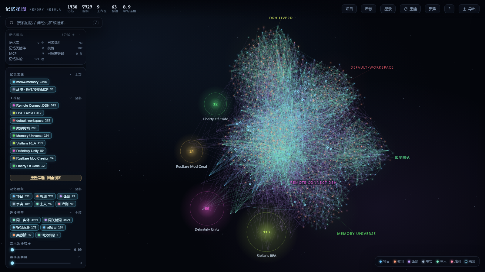
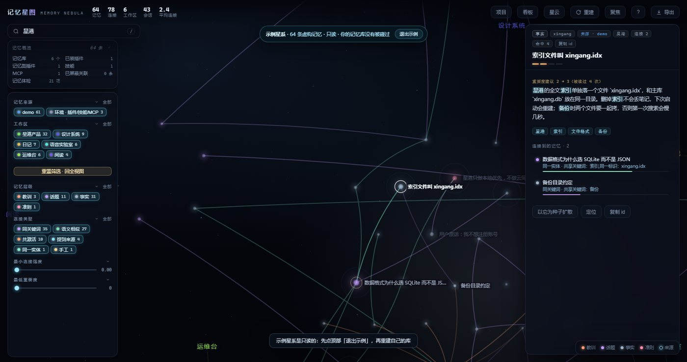
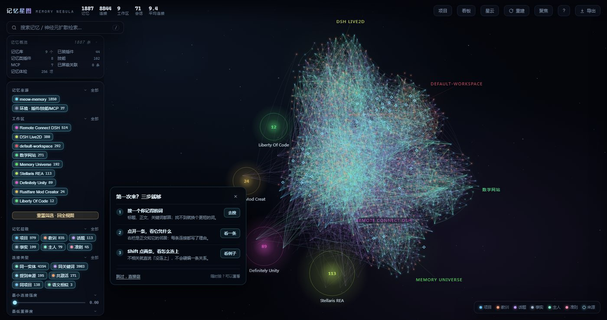
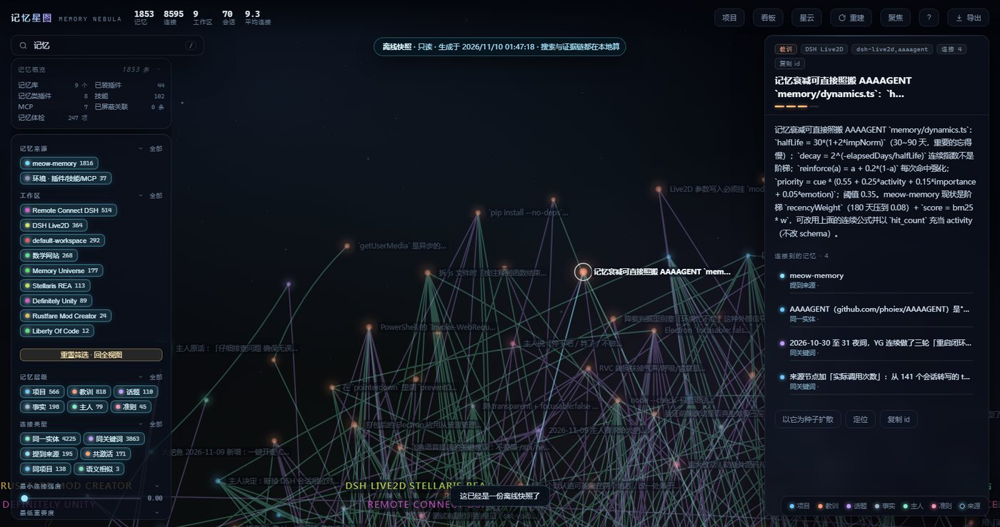
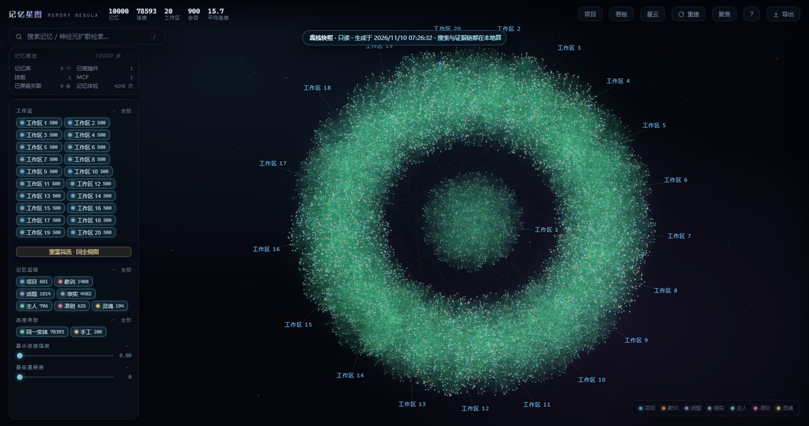

# Memory Nebula

Turn memories scattered across workspaces into a star map you can walk, query and carry away.

Memories in DSH often live across dozens of workspaces and thousands of sessions. Search returns a list, but not **why** those memories relate; switch projects and the thread disappears. Memory Nebula reads the same stores (meow-memory / OpenViking) and builds a graph: nodes are memories, edges are shared keywords, entities, projects, session co-activation and manual curation. It never copies or rewrites your stores. Everything is computed locally.



## Three ways to look

- **Nebula**: every memory in one cloud, clustered by workspace and coloured by level and link strength. Good for “what does my memory look like as a whole?”
- **Galaxy**: grouped by workspace; open a cluster to enter that project. Good for “what have I thought about here?”
- **Time**: memories arranged as a river by creation/update time, with a scrubber. Good for “how did this grow?”

All three share the same filters: workspace, level, edge type, minimum strength and importance. Switching views keeps the selection.

## From one memory to another

Select a node and the right panel shows what it connects to and why: same project, shared keywords, same entity, repeatedly co-mentioned in sessions, or a link you made yourself. Every neighbour carries a weight and a reason, not an evidence-free “similarity 0.87”.

Shift-click a second node to find an **evidence chain**: every hop, its reason and the chain strength. If there is no path, it says so instead of inventing one.



## Search and spread

Search covers titles, bodies and keywords. Results mark direct hits versus nodes reached by spreading, and cross-workspace hits are called out so nothing hides behind the current filter.

“Spread from here” is not a second search box: it starts at this memory and walks existing links up to two hops, answering “what else is attached to this?”

## Hygiene, including the ugly parts

Six read-only checks:

- near-duplicate memories;
- oversized memories;
- stale memories that have not changed in a long time;
- memories stored but never read;
- many edges but no strong relation (keyword noise);
- completely isolated memories.

Diagnosis only. It never merges, deletes or rewires anything; that stays your call.

## Demo galaxy and first-visit guide

An empty store no longer means a black screen: open the **demo galaxy**, 64 fictional memories that are read-only and never touch your stores. First time in a real store, a three-step guide helps you search a word, open one memory and see its evidence, then Shift-click two nodes to see how they connect. Skip it anytime; press `?` to replay.



## Share a slice, not the whole store

Export the whole map, the current workspace, or “two hops around this memory” as a **single-file HTML**:

- double-click to open, no DSH and no network;
- search, neighbours and evidence chains run locally;
- read-only, cannot touch your stores;
- optionally hide the Diary workspace before export; `scope`/`hide` affect the export only;
- the file is a point-in-time copy **including the text** — check the scope before sending it.



## Ten thousand memories, still opens

Same-machine benchmark with 10,000 memories and 78,593 links:

- graph build 1.2 s;
- first paint about 0.6 s;
- recall 4.9 ms;
- single-file snapshot 122 ms / 21 MB;
- heap 145 MB.

Above 3,000 memories it stays in the 2D nebula and asks you to filter before switching to 3D: software rendering would choke, and the map does not pretend otherwise.



## Install

Add this index in the DSH plugin market:

```text
https://unpkg.com/dsh-memory-nebula@1.1.8/market/index.json
```

Then search for “Memory Nebula” and install. Or install the npm package directly:

```bash
npm install dsh-memory-nebula@1.1.8
```

Run the read-only doctor after installing:

```bash
npx memory-nebula-doctor --profile <your DSH profile directory>
```

It checks the Node version, package files, profile dependency, bundle declaration, memory sources and an optional `/ping` endpoint. Nothing is uploaded.

## Boundaries

- single-user, local tool: no accounts, do not expose it to the public internet;
- the stores are read-only: the map never edits memories for you;
- 3D needs WebGL2;
- snapshots contain the text inside the selected scope; treat them as plain-text backups;
- server-side diagnostics and logs are mostly Chinese; the UI is bilingual.

## More

- architecture, data model, HTTP API, compatibility and distribution docs ship in `docs/`
- License: MIT
