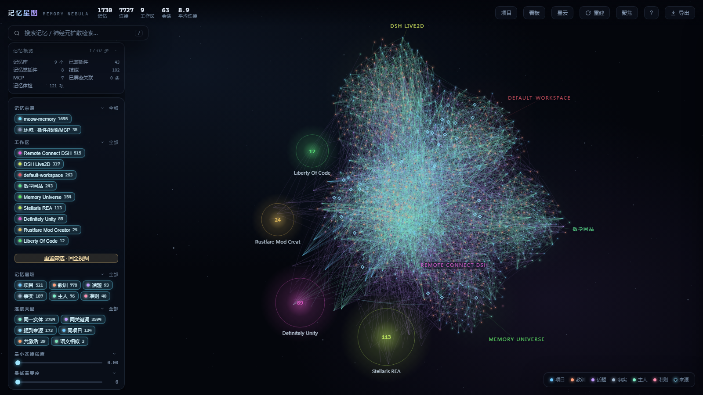
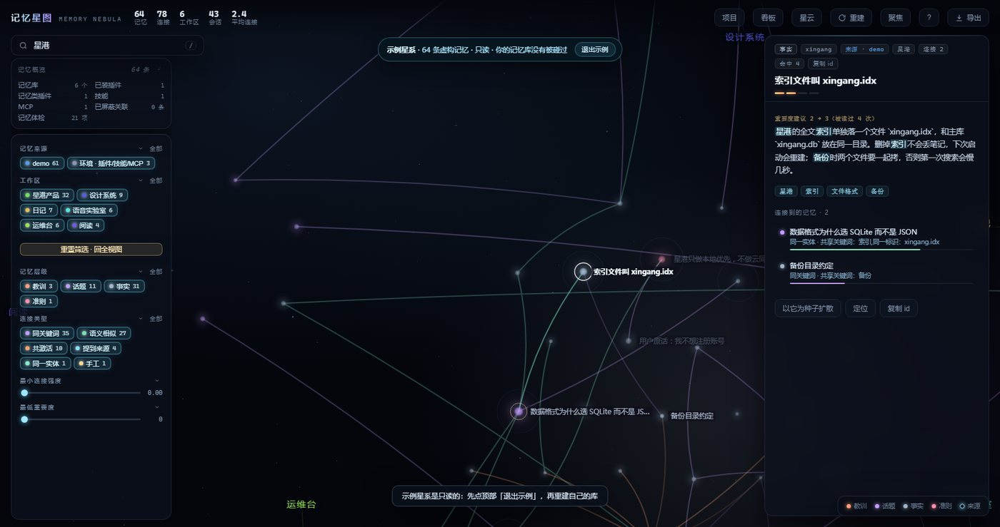
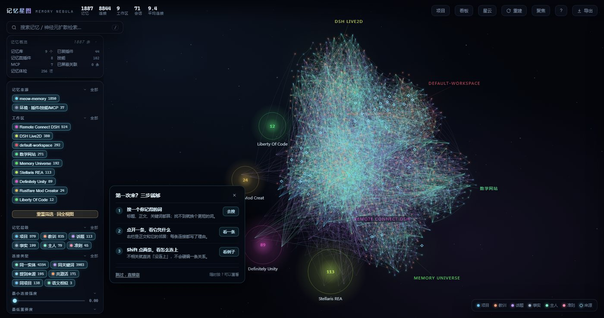
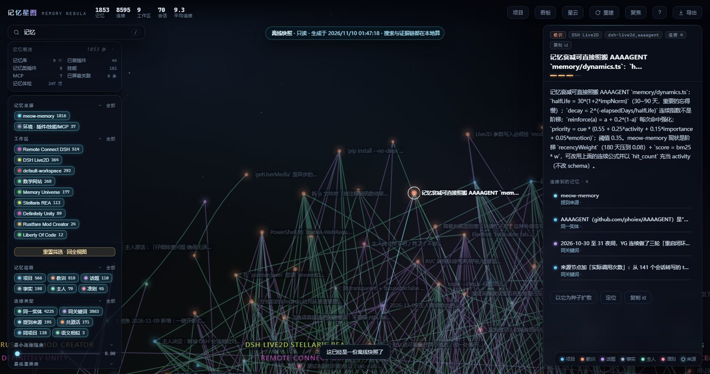
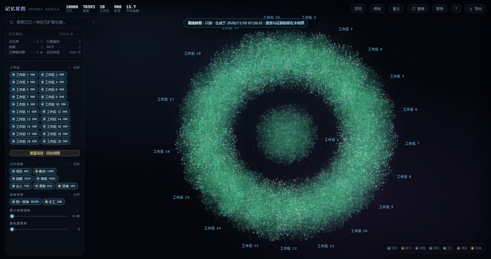

# 记忆星图

把散落在工作区里的记忆，连成一张能走、能查、能带走的星图。

DSH 里的记忆常常躺在几十个工作区、几千条会话里。搜索能给出一串结果，但看不到它们**为什么**相关；换一个项目，之前那条线索又断了。记忆星图读同一批记忆库（meow-memory / OpenViking），把它们建成一张图：节点是记忆，边是关键词、实体、项目、会话共现和人工策展。它不复制、不改写你的库，所有计算都在本机完成。



## 三种看法

- **星云**：全部记忆铺成星云，按工作区聚成星团，按层级与连接强度着色。适合看「我的记忆整体长什么样」。
- **星系**：按工作区分组，点开一团就进入那个项目。适合回答「这个项目里我都想过什么」。
- **时间**：按创建/更新时间排成一条河，拖动时间轴回放。适合看「这件事是怎么一步步长出来的」。

三种视图共用同一套筛选：工作区、层级、连接类型、最小强度、最低重要度。切视图不丢选中。

## 从一条记忆走到另一条

选中节点，右侧会告诉你它和谁相连、为什么相连：同项目、共享关键词、同一实体、被同一批会话反复一起提到，或者你亲手连的。每条邻居都带权重和理由，不是「相似度 0.87」这种没有证据的数字。

Shift 点第二个节点，会找两点之间的**证据链**：每一跳是哪条边、什么理由、链强度多少。找不到就明说找不到，不编一条路。



## 搜索与扩散

搜索是全文的：标题、正文、关键词都算。结果里会标出是直接命中，还是从别的节点扩散过来的；跨工作区命中会单独标出来，避免「明明有却搜不到」。

「以它为种子扩散」不是搜索的替代品：它从这条记忆出发，沿已有连接看两跳内的邻居，告诉你「还有哪些东西和它连着」。

## 体检：不只看漂亮的那面

星图会做六类只读体检：

- 近似重复的记忆；
- 过长的记忆；
- 很久没更新、可能过时的记忆；
- 存了但从没被读过的记忆；
- 边很多但没有一条强关系（关键词撞出来的）；
- 完全孤立的记忆。

只诊断，不自动改库。要不要合并、删掉、补连接，由你决定。

## 示例星系与首访引导

第一次打开时，如果库还是空的，不会只给你一片黑：可以进「示例星系」逛一圈。示例是 64 条**虚构**记忆，只读，不写盘，退出后回到你自己的库。第一次进真实库还有三步引导：搜一个词、点开一条看证据、Shift 点两条看它们怎么连。跳过随时可以按 `?` 重看。



## 分享一片，而不是整座库

可以把整张图、当前工作区、或「以某条记忆为中心 2 跳」导出成一个**单文件 HTML**：

- 双击就能看，不需要 DSH、不需要网络；
- 搜索、邻居、证据链都在本地算；
- 只读，不能改你的库；
- 导出前可以勾选「隐去日记工作区」；`scope`/`hide` 只影响导出，不动原库；
- 分享出去的是时间点副本，正文会一起带走——发给别人前先确认范围。



## 一万条也敢开

10,000 条记忆、78,593 条连接的同机基准：

- 建图 1.2 秒；
- 首屏约 0.6 秒；
- 检索 4.9 毫秒；
- 单文件快照 122 毫秒 / 21MB；
- 堆内存 145MB。

超过 3,000 条时默认留在二维星云，并提示先筛选再切三维：软件渲染下三维会卡，星图不假装自己扛得住。



## 安装

在 DSH 的插件市场里添加索引：

```text
https://unpkg.com/dsh-memory-nebula@1.2.0/market/index.json
```

然后搜索「记忆星图」安装。也可以直接装 npm 包：

```bash
npm install dsh-memory-nebula@1.2.0
```

装完先体检：

```bash
npx memory-nebula-doctor --profile <你的 DSH profile 目录>
```

它会检查 Node 版本、包文件、profile 依赖、bundle 声明、记忆源和可选的 `/ping` 端点。只读，不上传任何东西。

## 边界

- 本机单用户工具，没有账号系统，不要把它暴露到公网；
- 记忆库是只读的：星图不会替你改记忆；
- 三维视图需要 WebGL2；
- 单文件快照包含被选中范围内的正文，按明文备份对待；
- 服务端诊断与日志仍以中文为主，界面中英双语。

## 更多

- 架构、数据模型、HTTP 接口、兼容矩阵与分发说明都随包发布，见 `docs/`
- 许可：MIT
